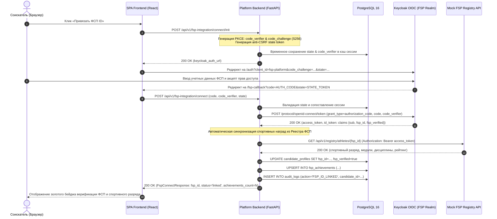

# Спецификация REST API (OpenAPI 3.1), безопасность, защита персональных данных (152-ФЗ) и интеграционные контракты
## Цифровая платформа-агрегатор ИТ-вакансий с верифицированным профилем достижений участника Федерации спортивного программирования (ФСП)

**Проект**: Цифровая платформа-агрегатор ИТ-вакансий ФСП (ЛЦТ 2026, Спецтрек ФСП)  
**Документ**: `docs/04_OPENAPI_CONTRACTS_AND_SECURITY.md`  
**Версия**: 1.0.0 (Release Candidate / Production Specification)  
**Статус**: Утвержден (Stage 0 Baseline Architecture)  
**Ответственный исполнитель**: Архитектурная группа (Worker M4)  
**Дата фиксации**: 2026-10-05  

---

## Архитектурный контекст и согласованность спецификаций

Настоящий документ представляет собой исчерпывающую техническую спецификацию программных интерфейсов REST API, ролевой модели безопасности, требований Федерального закона № 152-ФЗ «О персональных данных», криптографических протоколов интеграции с Федерацией спортивного программирования (ФСП ID через Keycloak OIDC и Реестр ФСП) и корпоративными ATS работодателей.

Документ находится в строгом 100% взаимном согласовании с предшествующими архитектурными спецификациями платформы:
1. `docs/01_REQUIREMENTS_TRACEABILITY_MATRIX.md` — сквозная трассировка всех 47 требований ТЗ (REQ-01 — REQ-47) и 20 граничных сценариев (EC-01 — EC-20);
2. `docs/02_DOMAIN_MODEL_AND_DB_SCHEMA.md` — 25 реляционных таблиц СУБД PostgreSQL 16, внешние ключи, CHECK-ограничения и триггеры аудита;
3. `docs/03_ALGORITHMS_AND_BUSINESS_LOGIC.md` — математический движок психометрического тестирования KITE IRT 3PL, антислив вариантов, многофакторный скоринг $S$ с Explainability и валидационный бенчмарк.

---

## Содержание документа

- [Раздел 1. Архитектура REST API и глобальные стандарты OpenAPI 3.1](#раздел-1-архитектура-rest-api-и-глобальные-стандарты-openapi-31)
  - [1.1. Базовые архитектурные конвенции и транспортный протокол](#11-базовые-архитектурные-конвенции-и-транспортный-протокол)
  - [1.2. Спецификация обработки ошибок (RFC 7807 Problem Details)](#12-спецификация-обработки-ошибок-rfc-7807-problem-details)
  - [1.3. Ролевая модель доступа (RBAC) и жизненный цикл JWT-токенов](#13-ролевая-модель-доступа-rbac-и-жизненный-цикл-jwt-токенов)
  - [1.4. Глобальные базовые схемы данных Pydantic v2](#14-глобальные-базовые-схемы-данных-pydantic-v2)
- [Раздел 2. Спецификация эндпоинтов и Pydantic v2 схем по 14 модулям](#раздел-2-спецификация-эндпоинтов-и-pydantic-v2-схем-по-14-модулям)
  - [2.1. Модуль 1: `auth` (Аутентификация и 152-ФЗ согласия)](#21-модуль-1-auth-аутентификация-и-152-фз-согласия)
  - [2.2. Модуль 2: `fsp-integration` (Связь с ФСП ID и реестром)](#22-модуль-2-fsp-integration-связь-с-фсп-id-и-реестром)
  - [2.3. Модуль 3: `candidate-profile` (Профиль соискателя и онбординг)](#23-модуль-3-candidate-profile-профиль-соискателя-и-онбординг)
  - [2.4. Модуль 4: `resume-pdf` (Распознавание и экспорт PDF)](#24-модуль-4-resume-pdf-распознавание-и-экспорт-pdf)
  - [2.5. Модуль 5: `assessment` (Адаптивное тестирование KITE)](#25-модуль-5-assessment-адаптивное-тестирование-kite)
  - [2.6. Модуль 6: `micro-challenges` (Инженерные задачи и песочница)](#26-модуль-6-micro-challenges-инженерные-задачи-и-песочница)
  - [2.7. Модуль 7: `employer-needs` (Потребности команд работодателей)](#27-модуль-7-employer-needs-потребности-команд-работодателей)
  - [2.8. Модуль 8: `candidate-bank` (Банк кандидатов и шортлисты)](#28-модуль-8-candidate-bank-банк-кандидатов-и-шортлисты)
  - [2.9. Модуль 9: `invitations` (Прямые приглашения работодателей)](#29-модуль-9-invitations-прямые-приглашения-работодателей)
  - [2.10. Модуль 10: `vacancies` (Витрина вакансий и управление)](#210-модуль-10-vacancies-витрина-вакансий-и-управление)
  - [2.11. Модуль 11: `applications` (Прямые отклики соискателей)](#211-модуль-11-applications-прямые-отклики-соискателей)
  - [2.12. Модуль 12: `ats-integration` (Шлюз ATS и вебхуки)](#212-модуль-12-ats-integration-шлюз-ats-и-вебхуки)
  - [2.13. Модуль 13: `validation-benchmark` (Бенчмарк валидации)](#213-модуль-13-validation-benchmark-бенчмарк-валидации)
  - [2.14. Модуль 14: `demo` (Демо-панель для жюри хакатона)](#214-модуль-14-demo-демо-панель-для-жюри-хакатона)
- [Раздел 3. Защита персональных данных (152-ФЗ), поколоночная матрица маскирования и мультитенантная изоляция](#раздел-3-защита-персональных-данных-152-фз-поколоночная-матрица-маскирования-и-мультитенантная-изоляция)
  - [3.1. Правовой базис и разграничение согласий (ст. 9, 10.1, 21 152-ФЗ РФ)](#31-правовой-базис-и-разграничение-согласий-ст-9-101-21-152-фз-рф)
  - [3.2. Поколоночная матрица видимости 30 полей профиля соискателя](#32-поколоночная-матрица-видимости-30-полей-профиля-соискателя)
  - [3.3. Разделение схем на уровне сериализатора бэкенда](#33-разделение-схем-на-уровне-сериализатора-бэкенда)
  - [3.4. Зависимость FastAPI проверки полномочий доступа к контактам](#34-зависимость-fastapi-проверки-полномочий-доступа-к-контактам)
  - [3.5. Мультитенантная изоляция и аудит инцидентов безопасности](#35-мультитенантная-изоляция-и-аудит-инцидентов-безопасности)
- [Раздел 4. Интеграция с Keycloak OIDC, ФСП ID и контракт Mock FSP Registry API](#раздел-4-интеграция-с-keycloak-oidc-фсп-id-и-контракт-mock-fsp-registry-api)
  - [4.1. Архитектура Authorization Code Flow с PKCE (RFC 7636)](#41-архитектура-authorization-code-flow-с-pkce-rfc-7636)
  - [4.2. Контракт Mock FSP Registry API](#42-контракт-mock-fsp-registry-api)
  - [4.3. Обработка кандидатов без истории ФСП (`fsp_id IS NULL` — Graceful Fallback)](#43-обработка-кандидатов-без-истории-фсп-fsp_id-is-null--graceful-fallback)
- [Раздел 5. Интеграция с ATS работодателей и протокол защищенных Webhook-уведомлений](#раздел-5-интеграция-с-ats-работодателей-и-протокол-защищенных-webhook-уведомлений)
  - [5.1. Контракт экспорта в Huntflow JSON](#51-контракт-экспорта-в-huntflow-json)
  - [5.2. Контракт экспорта в HeadHunter / Talantix JSON](#52-контракт-экспорта-в-headhunter--talantix-json)
  - [5.3. Контракт импорта вакансий из ATS с валидацией зарплат](#53-контракт-импорта-вакансий-из-ats-с-валидацией-зарплат)
  - [5.4. Протокол HMAC-SHA256 подписи, Replay-защита и сетка повторов с DLQ](#54-протокол-hmac-sha256-подписи-replay-защита-и-сетка-повторов-с-dlq)
- [Раздел 6. Встраиваемый исполняемый Quality Gate скрипт (Python 3.12+ stdlib-only)](#раздел-6-встраиваемый-исполняемый-quality-gate-скрипт-python-312-stdlib-only)
  - [6.1. Исходный код Quality Gate](#61-исходный-код-quality-gate)
  - [6.2. Протокол и инструкция по запуску](#62-протокол-и-инструкция-по-запуску)

---

## Раздел 1. Архитектура REST API и глобальные стандарты OpenAPI 3.1

### 1.1. Базовые архитектурные конвенции и транспортный протокол

Программный интерфейс платформы спроектирован в строгом соответствии с архитектурным стилем REST и спецификацией OpenAPI 3.1.0:

1. **Базовый URI и версионирование**:
   - Все эндпоинты платформы располагаются под единым префиксом `/api/v1`.
   - Версионирование осуществляется исключительно на уровне пути URL (`/api/v1/...`). Обратная несовместимость требует выпуска новой мажорной версии (`/api/v2`).
2. **Форматы данных и кодировка**:
   - Запросы и ответы передаются исключительно в формате `application/json; charset=utf-8` (за исключением загрузки multipart-файлов резюме и выгрузки бинарных PDF-документов `application/pdf`).
   - Имена всех полей JSON сериализуются в нотации `snake_case`.
   - Временные метки передаются в формате ISO 8601 (RFC 3339) с явным указанием таймзоны UTC: `YYYY-MM-DDTHH:MM:SSZ`.
3. **Стандарт пагинации**:
   - Коллекции данных поддерживают двухуровневую адресацию:
     * Офсетная пагинация: query-параметры `limit` (целое число 1..100, по умолчанию 20) и `offset` (целое число $\ge 0$, по умолчанию 0);
     * Страничная пагинация: query-параметры `page` (целое число $\ge 1$, по умолчанию 1) и `page_size` (целое число 1..100, по умолчанию 20).
   - В ответе коллекций возвращается мета-объект `PaginationMeta` с общим количеством элементов `total`, текущей страницей `page` и числом страниц `total_pages`.
4. **Заголовки безопасности и транспортная защита**:
   - `Strict-Transport-Security: max-age=31536000; includeSubDomains; preload`
   - `X-Content-Type-Options: nosniff`
   - `X-Frame-Options: DENY`
   - `Content-Security-Policy: default-src 'self'; frame-ancestors 'none';`
   - `Cache-Control: no-store, no-cache, must-revalidate` (для всех чувствительных API профилей, тестирования и контактов)
5. **CORS и защита доверенных источников**:
   - Поддерживаются только доверенные Origin веб-клиентов (`https://platform.fsp.ru`, `http://localhost:5173` для разработки).
   - `Access-Control-Allow-Credentials: true`.
6. **Ограничение интенсивности запросов (Rate Limiting)**:
   - Общий лимит для публичных эндпоинтов: 60 запросов в минуту на IP-адрес.
   - Лимит для авторизованных пользователей: 300 запросов в минуту на пользователя.
   - Жесткая квота на отправку приглашений работодателями (Token Bucket, антиспам LHH): не более 20 приглашений в сутки на одну организацию (`ERR_INVITE_DAILY_QUOTA_EXCEEDED`, HTTP 429).

---

### 1.2. Спецификация обработки ошибок (RFC 7807 Problem Details)

Платформа реализует единый стандарт возврата ошибок на основе спецификации RFC 7807 (*Problem Details for HTTP APIs*). Любой ответ со статусом $4xx$ или $5xx$ возвращает стандартизированный JSON следующего формата:

```json
{
  "error_code": "ERR_COOLDOWN_ACTIVE",
  "message": "Повторная сдача теста заблокирована. До окончания кулдауна осталось 78 дней.",
  "status_code": 409,
  "details": [
    {
      "loc": ["body", "category_id"],
      "msg": "Active cooldown lock until 2026-12-24T18:00:00Z",
      "type": "cooldown_violation"
    }
  ],
  "timestamp": "2026-10-05T22:30:00Z",
  "path": "/api/v1/assessment/sessions/start"
}
```

#### Реестр канонических кодов ошибок платформы

| Код ошибки (`error_code`) | HTTP статус | Описание бизнес-ситуации |
|---|:---:|---|
| `ERR_UNAUTHORIZED` | 401 | Отсутствует, просрочен или невалиден JWT Bearer токен |
| `ERR_FORBIDDEN` | 403 | Недостаточно привилегий RBAC для вызова данного метода |
| `ERR_152FZ_CONTACTS_MASKED` | 403 | Попытка прямого доступа к контактам соискателя без взаимного согласия |
| `ERR_CONTACTS_UNAUTHORIZED` | 403 | Обращение к контактам чужого кандидата другим работодателем |
| `ERR_RESOURCE_NOT_FOUND` | 404 | Запрошенная сущность (профиль, вакансия, инвайт) не найдена |
| `ERR_COOLDOWN_ACTIVE` | 409 | Действует 90-дневный кулдаун смены грейда после завершения тестирования |
| `ERR_INVITATION_ALREADY_RESOLVED` | 409 | Приглашение уже принято или отклонено ранее |
| `ERR_APPLICATION_DUPLICATE` | 409 | Соискатель уже подал отклик на данную вакансию |
| `ERR_FSP_ALREADY_LINKED` | 409 | Указанный ФСП ID уже привязан к другой учетной записи |
| `ERR_SALARY_MIN_NOT_POSITIVE` | 422 | Значение `salary_min` меньше либо равно 0 (сокрытие зарплаты запрещено) |
| `ERR_SALARY_MAX_LT_MIN` | 422 | Значение `salary_max` меньше `salary_min` (перевернутая вилка) |
| `ERR_SUSPICIOUS_SALARY_SPREAD` | 422 | Разброс зарплатной вилки $\text{max}/\text{min} > 3.5$ (антифрод аномалий) |
| `ERR_INVALID_INN_CHECKSUM` | 422 | Не пройдена проверка контрольных разрядов ИНН по весовым коэффициентам ФНС |
| `ERR_INVITE_DAILY_QUOTA_EXCEEDED`| 429 | Превышен суточный лимит исходящих приглашений (20 инвайтов/сутки) |
| `ERR_FSP_REGISTRY_UNAVAILABLE` | 502 | Сбой внешнего соединения с реестром ФСП или Keycloak |

---

### 1.3. Ролевая модель доступа (RBAC) и жизненный цикл JWT-токенов

Платформа использует четырехролевую модель управления доступом на основе ролей (Role-Based Access Control, RBAC):

1. **`public`**: Неаутентифицированные пользователи. Доступ к регистрации, аутентификации, каталогу публичных вакансий и витрине категорий.
2. **`candidate`**: Соискатели (ИТ-специалисты и спортсмены ФСП). Доступ к собственному профилю, онбордингу, KITE-тестированию, микро-челленджам, входящим инвайтам и собственным откликам.
3. **`employer`**: Представители работодателей (верифицированные по ИНН организации). Доступ к созданию потребностей, банку анонимизированных талантов, отправке инвайтов с обязательной ЗП, получению полных контактов принявших соискателей и ATS-интеграции.
4. **`admin`**: Администраторы платформы и члены экспертного жюри. Полный аудит, управление системными параметрами, запуск валидационных бенчмарков и мгновенный сброс кулдаунов.

#### Архитектура JWT-токенов

- **Access Token**:
  * Время жизни: 15 минут (900 секунд).
  * Алгоритм подписи: HMAC-SHA256 (`HS256`) или RSA-SHA256 (`RS256`).
  * Полезная нагрузка (Claims):
    ```json
    {
      "sub": "usr_019283a1b2c3",
      "user_id": 1042,
      "email": "alex.kovalev@example.com",
      "role": "candidate",
      "profile_id": 512,
      "is_fsp_verified": true,
      "iss": "https://platform.fsp.ru",
      "aud": "https://platform.fsp.ru/api",
      "exp": 1775420100,
      "iat": 1775419200
    }
    ```
- **Refresh Token**:
  * Время жизни: 7 суток (604 800 секунд).
  * Хранение в базе: криптографический хэш SHA-256 в таблице `refresh_tokens`.
  * Ротация: одноразовый (при каждом обновлении старый токен аннулируется, выпускается новая пара).

---

### 1.4. Глобальные базовые схемы данных Pydantic v2

```python
"""
Глобальные базовые схемы Pydantic v2 для всей платформы ФСП.
Python 3.12 / Pydantic v2.7+ / FastAPI
"""
from __future__ import annotations

from datetime import datetime
from enum import StrEnum
from typing import Annotated, Any, Dict, List, Literal, Optional, Union
from pydantic import BaseModel, ConfigDict, Field


class UserRole(StrEnum):
    CANDIDATE = "candidate"
    EMPLOYER = "employer"
    ADMIN = "admin"
    PUBLIC = "public"


class BaseSchema(BaseModel):
    """Базовый класс для всех Pydantic-схем платформы."""
    model_config = ConfigDict(
        from_attributes=True,
        populate_by_name=True,
        str_strip_whitespace=True,
        extra="forbid",
    )


class ErrorDetail(BaseSchema):
    """Детализация ошибки валидации конкретного поля запроса."""
    loc: List[Union[str, int]] = Field(..., description="Путь к полю в теле/параметрах запроса")
    msg: str = Field(..., description="Текстовое описание нарушения")
    type: str = Field(..., description="Машиночитаемый идентификатор типа ошибки")


class ErrorResponse(BaseSchema):
    """Единый формат возврата ошибок по спецификации RFC 7807."""
    error_code: str = Field(..., description="Канонический машиночитаемый код ошибки")
    message: str = Field(..., description="Понятное человеку описание ошибки на русском языке")
    status_code: int = Field(..., description="HTTP статус-код ответа")
    details: Optional[List[ErrorDetail]] = Field(default=None, description="Список детальных ошибок валидации полей")
    timestamp: datetime = Field(default_factory=datetime.utcnow, description="Метка времени фиксации ошибки в UTC")
    path: Optional[str] = Field(default=None, description="Относительный URL запроса")


class PaginationMeta(BaseSchema):
    """Метаданные пагинации для коллекций сущностей."""
    total: int = Field(ge=0, description="Общее число элементов под фильтром")
    page: int = Field(ge=1, description="Номер текущей страницы")
    page_size: int = Field(ge=1, le=100, description="Количество элементов на странице")
    total_pages: int = Field(ge=0, description="Всего страниц")


class StatusMessageResponse(BaseSchema):
    """Универсальный успешный ответ с информационным сообщением."""
    status: Literal["ok"] = "ok"
    message: str = Field(..., description="Информационное сообщение о результате операции")


class AuditLogEntry(BaseSchema):
    """Схема записи неизменяемого журнала аудита безопасности."""
    id: int
    user_id: Optional[int]
    action: str
    target_entity: str
    target_id: Optional[int]
    ip_address: Optional[str]
    user_agent: Optional[str]
    metadata_json: Dict[str, Any]
    created_at: datetime
```


---

## Раздел 2. Спецификация эндпоинтов и Pydantic v2 схем по 14 модулям

В данном разделе представлены исчерпывающие спецификации всех 89 программных эндпоинтов платформы и строго типизированных Pydantic v2 моделей для каждого из 14 модулей.

### 2.1. Модуль 1: `auth` (Аутентификация и 152-ФЗ согласия)

Модуль обеспечивает защищенную регистрацию, многофакторную валидацию учетных записей, двухфакторное подтверждение согласий 152-ФЗ РФ, выпуск и ротацию JWT токенов, а также юридически значимую фиксацию изменений оферты.

#### Реестр эндпоинтов Модуля 1

| Метод и путь | Описание бизнес-функции | RBAC роль | Схема запроса | Схема ответа | HTTP коды возврата |
|---|---|:---:|---|---|---|
| `POST /api/v1/auth/register` | Первичная регистрация соискателя или работодателя с фиксацией согласий 152-ФЗ | `public` | `UserRegisterRequest` | `UserRegisterResponse` | 201, 400, 409, 422 |
| `POST /api/v1/auth/login` | Аутентификация по OAuth2 Password Bearer и выдача пары JWT | `public` | `OAuth2PasswordRequestForm` / `LoginRequest` | `TokenResponse` | 200, 401, 403, 422 |
| `POST /api/v1/auth/refresh` | Ротация и обновление Access токена по одноразовому Refresh токену | `public` | `TokenRefreshRequest` | `TokenRefreshResponse` | 200, 401, 422 |
| `POST /api/v1/auth/logout` | Отзыв активной сессии и аннулирование Refresh токена | `candidate`, `employer`, `admin` | `LogoutRequest` | `StatusMessageResponse` | 200, 401 |
| `GET /api/v1/auth/me` | Получение профиля аутентифицированного пользователя и статуса согласий | `candidate`, `employer`, `admin` | — | `UserProfileResponse` | 200, 401, 403 |
| `POST /api/v1/auth/change-password` | Безопасная смена пароля текущего пользователя | `candidate`, `employer`, `admin` | `ChangePasswordRequest` | `StatusMessageResponse` | 200, 400, 401, 422 |
| `POST /api/v1/auth/verify-email` | Подтверждение email по одноразовому криптографическому токену | `public` | `VerifyEmailRequest` | `StatusMessageResponse` | 200, 400, 409 |
| `GET /api/v1/auth/consents` | Просмотр детального юридического статуса согласий 152-ФЗ | `candidate`, `employer` | — | `UserConsentResponse` | 200, 401 |
| `PUT /api/v1/auth/consents` | Изменение или отзыв согласий на распространение ПДн (ст. 10.1 152-ФЗ) | `candidate`, `employer` | `UpdateConsentRequest` | `UserConsentResponse` | 200, 401, 422 |

#### Pydantic v2 модели Модуля 1

```python
"""
Pydantic v2 модели Модуля 1: auth & 152-ФЗ compliance.
"""
from __future__ import annotations
import re
from datetime import datetime
from typing import Annotated, Dict, List, Literal, Optional
from pydantic import EmailStr, Field, field_validator, model_validator
from app.schemas.base import BaseSchema, UserRole, StatusMessageResponse


def validate_inn_checksum(inn: str) -> bool:
    """Алгоритмическая проверка контрольных разрядов ИНН по весам ФНС РФ."""
    if not re.match(r"^\d{10}$|^\d{12}$", inn):
        return False
    if len(inn) == 10:
        weights = [2, 4, 10, 3, 5, 9, 4, 6, 8]
        control = sum(int(inn[i]) * weights[i] for i in range(9)) % 11 % 10
        return control == int(inn[9])
    elif len(inn) == 12:
        weights_11 = [7, 2, 4, 10, 3, 5, 9, 4, 6, 8]
        control_11 = sum(int(inn[i]) * weights_11[i] for i in range(10)) % 11 % 10
        weights_12 = [3, 7, 2, 4, 10, 3, 5, 9, 4, 6, 8]
        control_12 = sum(int(inn[i]) * weights_12[i] for i in range(11)) % 11 % 10
        return control_11 == int(inn[10]) and control_12 == int(inn[11])
    return False


class UserRegisterRequest(BaseSchema):
    email: EmailStr = Field(..., description="Корпоративный или личный адрес электронной почты")
    password: str = Field(..., min_length=8, max_length=128, description="Пароль учетной записи")
    role: UserRole = Field(..., description="Роль при регистрации: candidate или employer")
    consent_pdn_processing: bool = Field(..., description="Согласие на обработку ПДн (ст. 9 152-ФЗ РФ)")
    consent_profile_publication: bool = Field(default=True, description="Согласие на публикацию (ст. 10.1 152-ФЗ)")
    policy_version: str = Field(default="v1.0-2026", description="Версия акцептованной политики конфиденциальности")
    first_name: Optional[str] = Field(None, min_length=2, max_length=100, description="Имя (для соискателя)")
    last_name: Optional[str] = Field(None, min_length=2, max_length=100, description="Фамилия (для соискателя)")
    company_name: Optional[str] = Field(None, min_length=2, max_length=255, description="Название компании")
    inn: Optional[str] = Field(None, description="ИНН организации (10 цифр) или ИП (12 цифр)")

    @field_validator("consent_pdn_processing")
    @classmethod
    def validate_mandatory_pdn(cls, v: bool) -> bool:
        if not v:
            raise ValueError("Регистрация невозможна без согласия на обработку ПДн (152-ФЗ)")
        return v

    @model_validator(mode="after")
    def validate_role_fields(self) -> "UserRegisterRequest":
        if self.role == UserRole.EMPLOYER:
            if not self.company_name:
                raise ValueError("Для работодателя обязательно указание наименования организации")
            if not self.inn:
                raise ValueError("Для работодателя обязательно указание ИНН")
            if not validate_inn_checksum(self.inn):
                raise ValueError("Указан некорректный контрольный разряд ИНН организации (ERR_INVALID_INN_CHECKSUM)")
        elif self.role == UserRole.CANDIDATE:
            if not self.first_name or not self.last_name:
                raise ValueError("Для соискателя обязательно указание имени и фамилии")
        return self


class TokenResponse(BaseSchema):
    access_token: str = Field(..., description="JWT Access Token (срок действия 15 минут)")
    refresh_token: str = Field(..., description="JWT Refresh Token (срок действия 7 дней)")
    token_type: Literal["bearer"] = "bearer"
    expires_in: int = Field(default=900, description="Время жизни Access токена в секундах")
    user_id: int
    role: UserRole
    email: EmailStr


class UserRegisterResponse(BaseSchema):
    user_id: int
    email: EmailStr
    role: UserRole
    tokens: TokenResponse
    is_email_verified: bool = False
    created_at: datetime


class LoginRequest(BaseSchema):
    email: EmailStr
    password: str


class TokenRefreshRequest(BaseSchema):
    refresh_token: str = Field(..., description="Одноразовый Refresh токен")


class TokenRefreshResponse(BaseSchema):
    access_token: str
    refresh_token: str
    token_type: Literal["bearer"] = "bearer"
    expires_in: int = 900


class LogoutRequest(BaseSchema):
    refresh_token: Optional[str] = None


class UserProfileResponse(BaseSchema):
    id: int
    email: EmailStr
    role: UserRole
    is_active: bool
    is_email_verified: bool
    candidate_profile_id: Optional[int] = None
    employer_profile_id: Optional[int] = None
    consent_pdn_processing: bool
    consent_profile_publication: bool
    created_at: datetime


class ChangePasswordRequest(BaseSchema):
    old_password: str
    new_password: str = Field(..., min_length=8, max_length=128)

    @model_validator(mode="after")
    def validate_passwords_differ(self) -> "ChangePasswordRequest":
        if self.old_password == self.new_password:
            raise ValueError("Новый пароль должен отличаться от старого")
        return self


class VerifyEmailRequest(BaseSchema):
    token: str = Field(..., min_length=32)


class UserConsentResponse(BaseSchema):
    user_id: int
    consent_pdn_processing: bool
    consent_profile_publication: bool
    policy_version: str
    accepted_at: datetime
    ip_address: Optional[str] = None
    revoked_at: Optional[datetime] = None


class UpdateConsentRequest(BaseSchema):
    consent_profile_publication: bool = Field(..., description="Флаг согласия на распространение ПДн (ст. 10.1)")
```

---

### 2.2. Модуль 2: `fsp-integration` (Связь с ФСП ID и реестром)

Модуль обеспечивает верификацию участников Федерации спортивного программирования России через Keycloak OIDC (PKCE Flow), привязку спортивного идентификатора (`fsp_id`), получение наград из Реестра ФСП, а также первоклассную обработку кандидатов без истории ФСП (`fsp_id = NULL`) без ошибок и без дискриминации.

#### Реестр эндпоинтов Модуля 2

| Метод и путь | Описание бизнес-функции | RBAC роль | Схема запроса | Схема ответа | HTTP коды возврата |
|---|---|:---:|---|---|---|
| `POST /api/v1/fsp-integration/connect` | Привязка ФСП ID через OIDC Authorization Code Flow с PKCE | `candidate` | `FspConnectRequest` | `FspConnectResponse` | 200, 400, 409, 502 |
| `GET /api/v1/fsp-integration/profile` | Получение досье ФСП (или статуса не-ФСП соискателя) | `candidate` | — | `FspProfileResponse` | 200, 401 |
| `POST /api/v1/fsp-integration/sync` | Принудительная синхронизация соревновательных наград из реестра | `candidate` | `FspSyncRequest` | `FspSyncResponse` | 200, 400, 401, 502 |
| `DELETE /api/v1/fsp-integration/unlink` | Отвязка ФСП ID, сброс верификации и перевод профиля на формулу не-ФСП | `candidate` | — | `StatusMessageResponse` | 200, 400, 401 |
| `GET /api/v1/fsp-integration/status` | Диагностика доступности Keycloak и реестра ФСП | `candidate`, `employer`, `admin` | — | `FspIntegrationStatusResponse` | 200, 401 |

#### Pydantic v2 модели Модуля 2

```python
"""
Pydantic v2 модели Модуля 2: fsp-integration.
"""
from __future__ import annotations
from datetime import datetime
from enum import StrEnum
from typing import Dict, List, Literal, Optional
from pydantic import Field, HttpUrl
from app.schemas.base import BaseSchema


class SportRankEnum(StrEnum):
    KMS = "kms"
    MS = "ms"
    FIRST_CLASS = "first_class"
    NONE = "none"


class FspDisciplineEnum(StrEnum):
    ALGORITHMIC = "algorithmic"
    PRODUCT = "product"
    INFOSEC = "infosec"
    ROBOTICS = "robotics"


class MedalEnum(StrEnum):
    GOLD = "gold"
    SILVER = "silver"
    BRONZE = "bronze"
    PARTICIPANT = "participant"


class FspAchievementRead(BaseSchema):
    id: str
    championship_name: str
    discipline: FspDisciplineEnum
    stage: str
    year: int
    place: Optional[int] = None
    medal: Optional[MedalEnum] = None
    sport_rank_awarded: Optional[SportRankEnum] = None
    rating_points_earned: int
    certificate_url: Optional[str] = None
    verified_at: datetime


class FspConnectRequest(BaseSchema):
    code: str = Field(..., description="Authorization code, полученный от Keycloak")
    redirect_uri: str = Field(..., description="Redirect URI, зарегистрированный в OIDC клиенте")
    code_verifier: str = Field(..., min_length=43, max_length=128, description="PKCE code verifier")


class FspConnectResponse(BaseSchema):
    fsp_id: str
    fsp_verified: bool
    athlete_name: str
    sport_rank: SportRankEnum
    rating_points: int
    achievements_synced: int
    linked_at: datetime


class FspProfileResponse(BaseSchema):
    is_fsp_candidate: bool = Field(..., description="Флаг: False для кандидатов без истории ФСП")
    fsp_id: Optional[str] = Field(None, description="NULL для соискателей без профиля в ФСП")
    fsp_verified: bool = Field(False, description="Подтверждена ли запись в реестре")
    athlete_name: Optional[str] = None
    sport_rank: SportRankEnum = SportRankEnum.NONE
    sport_rank_title: str = Field(..., description="Читаемое наименование разряда на русском")
    rating_points: int = 0
    contests_count: int = 0
    badge_title: str = Field(..., description="Золотой бейдж ФСП или 'Общий трек (IT-Талант)'")
    achievements: List[FspAchievementRead] = Field(default_factory=list)
    last_synced_at: Optional[datetime] = None


class FspSyncRequest(BaseSchema):
    force_refresh: bool = Field(default=False, description="Принудительный опрос внешнего реестра в обход кэша")


class FspSyncResponse(BaseSchema):
    fsp_id: str
    achievements_total: int
    rating_points: int
    sport_rank: SportRankEnum
    synced_at: datetime


class FspIntegrationStatusResponse(BaseSchema):
    keycloak_reachable: bool
    registry_reachable: bool
    latency_ms: float
    checked_at: datetime
```

---

### 2.3. Модуль 3: `candidate-profile` (Профиль соискателя и онбординг)

Модуль управляет анкетой соискателя, прохождением обязательного онбординг-опроса, закреплением подтвержденной категории (`Specialization + Verified Grade`), отслеживанием индекса актуальности профиля ($S_{\text{freshness}}$) и кулдауна смены грейда.

#### Реестр эндпоинтов Модуля 3

| Метод и путь | Описание бизнес-функции | RBAC роль | Схема запроса | Схема ответа | HTTP коды возврата |
|---|---|:---:|---|---|---|
| `POST /api/v1/candidate-profile/onboarding-survey` | Завершение обязательного онбординга (специализация, стек, заявляемый грейд) | `candidate` | `OnboardingSurveyRequest` | `OnboardingSurveyResponse` | 201, 400, 401, 409 |
| `GET /api/v1/candidate-profile/me` | Получение полного собственного профиля (Self-view со всеми контактами) | `candidate` | — | `CandidateFullProfileResponse` | 200, 401, 404 |
| `PUT /api/v1/candidate-profile/me` | Обновление биографии, города, формата работы и ожидаемой зарплаты | `candidate` | `CandidateProfileUpdateRequest` | `CandidateFullProfileResponse` | 200, 400, 401, 422 |
| `GET /api/v1/candidate-profile/category` | Просмотр подтвержденной категории LHH и таймера 90-дневного кулдауна | `candidate` | — | `CandidateCategoryStatusResponse` | 200, 401 |
| `GET /api/v1/candidate-profile/freshness` | Мониторинг индекса актуальности ($S_{\text{freshness}}$) и периода полураспада | `candidate` | — | `FreshnessScoreResponse` | 200, 401 |
| `PUT /api/v1/candidate-profile/privacy` | Настройки публичности профиля в Банке талантов | `candidate` | `PrivacySettingsUpdateRequest` | `PrivacySettingsResponse` | 200, 401, 422 |

#### Pydantic v2 модели Модуля 3

```python
"""
Pydantic v2 модели Модуля 3: candidate-profile.
"""
from __future__ import annotations
from datetime import datetime
from enum import StrEnum
from typing import Dict, List, Literal, Optional
from pydantic import EmailStr, Field, HttpUrl, field_validator
from app.schemas.base import BaseSchema


class WorkFormatEnum(StrEnum):
    REMOTE = "remote"
    OFFICE = "office"
    HYBRID = "hybrid"
    ANY = "any"


class CandidateSkillItem(BaseSchema):
    skill_name: str = Field(..., min_length=1, max_length=100)
    years_of_experience: float = Field(ge=0.0, le=50.0)
    verified_by_test: bool = False


class OnboardingSurveyRequest(BaseSchema):
    specialization_id: int = Field(..., description="ID канонической специализации (1..6)")
    claimed_grade_id: int = Field(..., description="Заявляемый начальный грейд (1..4)")
    skills: List[str] = Field(..., min_length=1, max_length=50, description="Ключевые технологии стека")
    city: str = Field(..., min_length=2, max_length=100, description="Город проживания")
    work_format: WorkFormatEnum = Field(default=WorkFormatEnum.ANY)
    relocation_ready: bool = Field(default=False)
    expected_salary: Optional[int] = Field(None, gt=0, description="Ожидаемая заработная плата в рублях")


class OnboardingSurveyResponse(BaseSchema):
    profile_id: int
    category_assigned_preliminary: str
    assessment_ready: bool = True
    next_action_url: str = "/api/v1/assessment/sessions/start"
    created_at: datetime


class CandidateFullProfileResponse(BaseSchema):
    id: int
    user_id: int
    first_name: str
    last_name: str
    middle_name: Optional[str] = None
    email: EmailStr
    phone: Optional[str] = None
    telegram: Optional[str] = None
    github_url: Optional[str] = None
    city: str
    work_format: WorkFormatEnum
    relocation_ready: bool
    expected_salary: Optional[int] = None
    bio: Optional[str] = None
    specialization: str
    grade: str
    category_title: str
    skills: List[CandidateSkillItem]
    kite_score_scaled: float
    fsp_id: Optional[str] = None
    fsp_verified: bool
    fsp_badge: str
    freshness_score: float
    is_published: bool
    created_at: datetime
    updated_at: datetime


class CandidateProfileUpdateRequest(BaseSchema):
    first_name: Optional[str] = Field(None, min_length=2, max_length=100)
    last_name: Optional[str] = Field(None, min_length=2, max_length=100)
    middle_name: Optional[str] = Field(None, max_length=100)
    phone: Optional[str] = Field(None, max_length=32)
    telegram: Optional[str] = Field(None, max_length=64)
    github_url: Optional[str] = Field(None, max_length=255)
    city: Optional[str] = Field(None, min_length=2, max_length=100)
    work_format: Optional[WorkFormatEnum] = None
    relocation_ready: Optional[bool] = None
    expected_salary: Optional[int] = Field(None, gt=0)
    bio: Optional[str] = Field(None, max_length=2000)


class CandidateCategoryStatusResponse(BaseSchema):
    candidate_id: int
    specialization_code: str
    grade_code: str
    category_badge: str
    is_grade_confirmed: bool
    cooldown_until: Optional[datetime] = None
    is_cooldown_active: bool
    days_left_cooldown: int


class FreshnessScoreResponse(BaseSchema):
    candidate_id: int
    freshness_score: float = Field(ge=0.0, le=100.0)
    half_life_days: int = 45
    last_activity_at: datetime
    activity_count_last_30d: int
    decay_status: Literal["active", "declining", "stale"]


class PrivacySettingsUpdateRequest(BaseSchema):
    is_published: bool = Field(..., description="Видимость профиля в Банке талантов")


class PrivacySettingsResponse(BaseSchema):
    candidate_id: int
    is_published: bool
    updated_at: datetime
```

---

### 2.4. Модуль 4: `resume-pdf` (Распознавание и экспорт PDF)

Модуль осуществляет безопасный парсинг загружаемых PDF-резюме соискателей (движок PyMuPDF с валидацией magic bytes `%PDF-`), а также динамическую сборку стандартизированных PDF-документов ФСП (движок ReportLab) в двух режимах: Mode A (анонимизированный до принятия инвайта) и Mode B (полный с демаскированными контактами).

#### Реестр эндпоинтов Модуля 4

| Метод и путь | Описание бизнес-функции | RBAC роль | Схема запроса | Схема ответа | HTTP коды возврата |
|---|---|:---:|---|---|---|
| `POST /api/v1/resume-pdf/parse` | Загрузка и автораспознавание структуры резюме из PDF (PyMuPDF) | `candidate` | Multipart form (`file`) | `ResumeParsedResponse` | 200, 400, 413, 415 |
| `GET /api/v1/resume-pdf/export-fsp/{candidate_id}` | Генерация стандартизированного PDF ФСП (Mode A vs Mode B с 152-ФЗ фильтром) | `candidate`, `employer`, `admin` | Query `mode: auto` | Binary PDF (`application/pdf`) | 200, 401, 403, 404 |
| `GET /api/v1/resume-pdf/preview-export` | Предпросмотр полного собственного PDF соискателем | `candidate` | — | Binary PDF (`application/pdf`) | 200, 401, 404 |

#### Pydantic v2 модели Модуля 4

```python
"""
Pydantic v2 модели Модуля 4: resume-pdf.
"""
from __future__ import annotations
from datetime import date
from enum import StrEnum
from typing import List, Optional
from pydantic import EmailStr, Field
from app.schemas.base import BaseSchema


class ExportModeEnum(StrEnum):
    AUTO = "auto"
    MODE_A_ANONYMIZED = "mode_a_anonymized"
    MODE_B_FULL = "mode_b_full"


class ParsedWorkExperience(BaseSchema):
    company_name: str
    position: str
    start_date: Optional[str] = None
    end_date: Optional[str] = None
    is_current: bool = False
    description: Optional[str] = None
    skills_detected: List[str] = Field(default_factory=list)


class ParsedEducation(BaseSchema):
    institution: str
    faculty: Optional[str] = None
    degree: Optional[str] = None
    graduation_year: Optional[int] = None


class ResumeParsedResponse(BaseSchema):
    detected_first_name: Optional[str] = None
    detected_last_name: Optional[str] = None
    detected_email: Optional[EmailStr] = None
    detected_phone: Optional[str] = None
    detected_telegram: Optional[str] = None
    detected_github: Optional[str] = None
    detected_city: Optional[str] = None
    extracted_skills: List[str] = Field(default_factory=list)
    work_experience: List[ParsedWorkExperience] = Field(default_factory=list)
    education: List[ParsedEducation] = Field(default_factory=list)
    total_experience_months: int = 0
    raw_text_length: int
```

---

### 2.5. Модуль 5: `assessment` (Адаптивное тестирование KITE)

Модуль реализует ядро адаптивного антислив-тестирования KITE (IRT 3PL). Поддерживает генерацию вариантов на базе HMAC-SHA256 seed, проверку решений в изолированной песочнице, автоматическое подтверждение грейда ($\theta \ge 70$), безопасный Boost-тест ($\theta \ge 88$) и некарательное право мгновенной пересдачи на грейд ниже ($\theta < 70$) без ожидания 90-дневного кулдауна.

#### Реестр эндпоинтов Модуля 5

| Метод и путь | Описание бизнес-функции | RBAC роль | Схема запроса | Схема ответа | HTTP коды возврата |
|---|---|:---:|---|---|---|
| `POST /api/v1/assessment/sessions/start` | Старт сессии тестирования KITE с проверкой 90-дневного кулдауна | `candidate` | `StartAssessmentSessionRequest` | `AssessmentSessionStartResponse` | 201, 400, 409 |
| `GET /api/v1/assessment/sessions/{id}/tasks/{task_index}` | Получение задания (1..12) с публичными тестами | `candidate` | Path: `id`, `task_index` | `AssessmentTaskItemResponse` | 200, 401, 403, 404, 410 |
| `POST /api/v1/assessment/sessions/{id}/answer` | Отправка решения и запуск проверки в песочнице | `candidate` | `SubmitTaskAnswerRequest` | `SubmitTaskAnswerResponse` | 200, 400, 401, 403, 404, 410 |
| `GET /api/v1/assessment/sessions/{id}/progress` | Мониторинг прогресса сессии (остаток времени, число решенных) | `candidate` | Path: `id` | `AssessmentSessionProgressResponse` | 200, 401, 403, 404 |
| `POST /api/v1/assessment/sessions/{id}/submit` | Завершение теста, расчет IRT EAP $\theta$ и вынесение вердикта | `candidate` | Path: `id` | `AssessmentSessionResultResponse` | 200, 400, 401, 403, 404 |
| `GET /api/v1/assessment/sessions/{id}/results` | Получение детальной аналитической карточки результатов тестирования | `candidate` | Path: `id` | `AssessmentSessionResultResponse` | 200, 401, 403, 404 |
| `POST /api/v1/assessment/sessions/{id}/boost-opt-in` | Запуск безопасного Boost-теста на грейд выше (при $\theta \ge 88$) | `candidate` | Path: `id` | `AssessmentSessionStartResponse` | 201, 400, 401, 403, 404 |
| `POST /api/v1/assessment/retest-lower` | Мгновенная сдача на грейд ниже при $\theta < 70$ (без ожидания кулдауна) | `candidate` | `RetestLowerGradeRequest` | `AssessmentSessionStartResponse` | 201, 400, 401, 403, 404 |

#### Pydantic v2 модели Модуля 5

```python
"""
Pydantic v2 модели Модуля 5: assessment (KITE Engine).
"""
from __future__ import annotations
from datetime import datetime
from enum import StrEnum
from typing import Any, Dict, List, Literal, Optional
from pydantic import Field
from app.schemas.base import BaseSchema


class SessionTypeEnum(StrEnum):
    INITIAL = "initial"
    BOOST = "boost"
    RETEST_LOWER = "retest_lower"


class SessionStatusEnum(StrEnum):
    IN_PROGRESS = "in_progress"
    COMPLETED = "completed"
    SUBMITTED = "submitted"
    EXPIRED = "expired"
    CANCELLED = "cancelled"


class TaskTypeEnum(StrEnum):
    ALGORITHMIC = "algorithmic"
    SYSTEM_DESIGN = "system_design"
    CODE_TRIAGE = "code_triage"
    CODE_SANDBOX = "code_sandbox"
    MCQ = "mcq"


class AssessmentVerdictEnum(StrEnum):
    CONFIRMED = "confirmed"
    BOOST_OFFERED = "boost_offered"
    RETEST_LOWER_OFFERED = "retest_lower_offered"
    FAILED = "failed"


class StartAssessmentSessionRequest(BaseSchema):
    category_id: int = Field(..., description="ID целевой категории (Specialization + Grade)")
    session_type: SessionTypeEnum = Field(default=SessionTypeEnum.INITIAL)


class AssessmentSessionStartResponse(BaseSchema):
    session_id: int
    category_id: int
    session_type: SessionTypeEnum
    tasks_count: int = 12
    time_limit_minutes: int = 90
    seed_hash: str = Field(..., description="Anti-leak seed hash сессии")
    started_at: datetime
    expires_at: datetime


class AssessmentTaskItemResponse(BaseSchema):
    session_id: int
    task_index: int = Field(..., ge=1, le=12)
    task_type: TaskTypeEnum
    title: str
    description: str
    code_template: Optional[str] = None
    public_tests: List[Dict[str, Any]] = Field(default_factory=list)
    time_limit_seconds: int = 300


class SubmitTaskAnswerRequest(BaseSchema):
    task_index: int = Field(..., ge=1, le=12)
    answer_payload: str = Field(..., description="Исходный код решения или ключ ответа")


class SubmitTaskAnswerResponse(BaseSchema):
    session_id: int
    task_index: int
    passed_public_tests: int
    total_public_tests: int
    verdict: Literal["accepted", "wrong_answer", "timeout", "runtime_error"]
    execution_time_ms: float


class AssessmentSessionProgressResponse(BaseSchema):
    session_id: int
    status: SessionStatusEnum
    tasks_answered: int
    tasks_total: int = 12
    seconds_remaining: int


class AssessmentSessionResultResponse(BaseSchema):
    session_id: int
    candidate_id: int
    theta_score: float = Field(..., description="Оценка IRT theta [0.0, 100.0]")
    scaled_score: float = Field(..., description="Масштабированный балл (0..100)")
    grade_confirmed: str
    verdict: AssessmentVerdictEnum
    boost_available: bool = False
    retest_lower_available: bool = False
    cooldown_until: Optional[datetime] = None
    completed_at: datetime


class RetestLowerGradeRequest(BaseSchema):
    failed_session_id: int
```

---

### 2.6. Модуль 6: `micro-challenges` (Инженерные задачи и песочница)

Модуль предоставляет каталог практических инженерных микро-задач от работодателей, запускаемых в изолированной среде WebAssembly/Docker. Решение задач обновляет индекс свежести соискателя ($S_{\text{freshness}}$) и повышает видимость в поисковой выдаче.

#### Реестр эндпоинтов Модуля 6

| Метод и путь | Описание бизнес-функции | RBAC роль | Схема запроса | Схема ответа | HTTP коды возврата |
|---|---|:---:|---|---|---|
| `GET /api/v1/micro-challenges` | Каталог активных инженерных микро-задач с фильтрацией | `candidate`, `employer`, `admin` | Query параметры | `MicroChallengeListResponse` | 200, 422 |
| `GET /api/v1/micro-challenges/{id}` | Детальная постановка задачи, лимиты памяти/времени и код-шаблон | `candidate`, `employer`, `admin` | Path: `id` | `MicroChallengeDetailResponse` | 200, 401, 404 |
| `POST /api/v1/micro-challenges/{id}/run-tests` | Прогон решения на публичных тестах в песочнице (Dry-run) | `candidate` | `RunChallengeTestsRequest` | `ChallengeDryRunResponse` | 200, 400, 401, 404, 422 |
| `POST /api/v1/micro-challenges/{id}/submit` | Финальная посылка решения, запуск скрытых тестов и начисление Freshness | `candidate` | `SubmitChallengeRequest` | `ChallengeSubmissionResponse` | 201, 400, 401, 404, 422 |
| `GET /api/v1/micro-challenges/{id}/submissions` | История попыток сдачи задания текущим соискателем | `candidate` | Path: `id` | `ChallengeSubmissionHistoryResponse` | 200, 401, 404 |
| `POST /api/v1/micro-challenges` | Создание работодателем новой инженерной задачи | `employer` | `CreateMicroChallengeRequest` | `MicroChallengeDetailResponse` | 201, 400, 401, 403, 422 |
| `PUT /api/v1/micro-challenges/{id}` | Обновление условий и тестов задачи автором | `employer` | `UpdateMicroChallengeRequest` | `MicroChallengeDetailResponse` | 200, 400, 401, 403, 404, 422 |
| `DELETE /api/v1/micro-challenges/{id}` | Деактивация микро-челленджа | `employer` | Path: `id` | `StatusMessageResponse` | 200, 401, 403, 404 |

#### Pydantic v2 модели Модуля 6

```python
"""
Pydantic v2 модели Модуля 6: micro-challenges.
"""
from __future__ import annotations
from datetime import datetime
from enum import StrEnum
from typing import Any, Dict, List, Literal, Optional
from pydantic import Field
from app.schemas.base import BaseSchema, PaginationMeta


class SubmissionStatusEnum(StrEnum):
    PASSED = "passed"
    FAILED = "failed"
    TIMEOUT = "timeout"
    ERROR = "error"


class TestCaseItem(BaseSchema):
    input_data: str
    expected_output: str
    is_public: bool = True


class MicroChallengeListItem(BaseSchema):
    id: int
    title: str
    specialization: str
    grade: str
    points: int
    freshness_boost: float
    time_limit_ms: int
    author_company_name: str
    is_solved_by_me: bool = False


class MicroChallengeListResponse(BaseSchema):
    items: List[MicroChallengeListItem]
    meta: PaginationMeta


class MicroChallengeDetailResponse(BaseSchema):
    id: int
    title: str
    description_markdown: str
    specialization: str
    grade: str
    starter_code: str
    public_tests: List[TestCaseItem]
    time_limit_ms: int
    memory_limit_mb: int
    points: int
    author_company_name: str
    created_at: datetime


class RunChallengeTestsRequest(BaseSchema):
    solution_code: str = Field(..., min_length=1, max_length=65536)


class ChallengeDryRunResponse(BaseSchema):
    all_passed: bool
    passed_count: int
    total_count: int
    logs: str
    execution_time_ms: float
    memory_used_mb: float


class SubmitChallengeRequest(BaseSchema):
    solution_code: str = Field(..., min_length=1, max_length=65536)


class ChallengeSubmissionResponse(BaseSchema):
    submission_id: int
    status: SubmissionStatusEnum
    points_awarded: int
    freshness_score_delta: float
    new_freshness_score: float
    submitted_at: datetime


class ChallengeSubmissionHistoryResponse(BaseSchema):
    challenge_id: int
    submissions: List[ChallengeSubmissionResponse]


class CreateMicroChallengeRequest(BaseSchema):
    specialization_id: int
    grade_id: int
    title: str = Field(..., min_length=5, max_length=200)
    description_markdown: str = Field(..., min_length=20)
    starter_code: str = Field(..., min_length=1)
    test_cases: List[TestCaseItem] = Field(..., min_length=2)
    time_limit_ms: int = Field(default=2000, ge=100, le=10000)
    memory_limit_mb: int = Field(default=128, ge=32, le=512)
    points: int = Field(default=25, ge=5, le=100)


class UpdateMicroChallengeRequest(BaseSchema):
    title: Optional[str] = Field(None, min_length=5, max_length=200)
    description_markdown: Optional[str] = Field(None, min_length=20)
    starter_code: Optional[str] = None
    test_cases: Optional[List[TestCaseItem]] = None
    time_limit_ms: Optional[int] = Field(None, ge=100, le=10000)
```

---

### 2.7. Модуль 7: `employer-needs` (Потребности команд работодателей)

Модуль реализует структурирование потребностей работодателей. В соответствии с инвариантами платформы и требованиями REQ-29, REQ-38, создание любой потребности требует **строго положительной зарплатной вилки в рублях** (`salary_min > 0 AND salary_max >= salary_min`), а разброс вилки не должен превышать коэффициент 3.5 (антифрод-барьер аномалий).

#### Реестр эндпоинтов Модуля 7

| Метод и путь | Описание бизнес-функции | RBAC роль | Схема запроса | Схема ответа | HTTP коды возврата |
|---|---|:---:|---|---|---|
| `POST /api/v1/employer-needs` | Создание структурированной потребности с обязательной вилкой в ₽ | `employer` | `CreateEmployerNeedRequest` | `EmployerNeedResponse` | 201, 400, 401, 403, 422 |
| `GET /api/v1/employer-needs` | Список потребностей текущего работодателя | `employer` | Query параметры | `EmployerNeedListResponse` | 200, 401, 403 |
| `GET /api/v1/employer-needs/{id}` | Детальная карточка потребности команды | `employer` | Path: `id` | `EmployerNeedResponse` | 200, 401, 403, 404 |
| `PUT /api/v1/employer-needs/{id}` | Обновление требований потребности (с валидацией зарплаты) | `employer` | `UpdateEmployerNeedRequest` | `EmployerNeedResponse` | 200, 400, 401, 403, 404, 422 |
| `PATCH /api/v1/employer-needs/{id}/close` | Закрытие потребности команды (`is_active = false`) | `employer` | Path: `id` | `EmployerNeedResponse` | 200, 401, 403, 404 |
| `DELETE /api/v1/employer-needs/{id}` | Удаление потребности и связанной истории подборок | `employer` | Path: `id` | `StatusMessageResponse` | 200, 401, 403, 404 |

#### Pydantic v2 модели Модуля 7

```python
"""
Pydantic v2 модели Модуля 7: employer-needs.
Обязательный инвариант: salary_min > 0 AND salary_max >= salary_min в рублях (RUB).
Антифрод: salary_max / salary_min <= 3.5.
"""
from __future__ import annotations
from datetime import datetime
from typing import Any, Dict, List, Literal, Optional
from pydantic import Field, field_validator, model_validator
from app.schemas.base import BaseSchema, PaginationMeta
from app.schemas.candidate_profile import WorkFormatEnum


class CreateEmployerNeedRequest(BaseSchema):
    specialization_id: int = Field(..., description="ID канонической специализации")
    grade_id: int = Field(..., description="ID требуемого грейда")
    title: str = Field(..., min_length=3, max_length=200, description="Наименование потребности команды")
    description: str = Field(..., min_length=10, max_length=5000, description="Описание задач и проекта")
    required_skills: List[str] = Field(..., min_length=1, description="Обязательный стек технологий")
    optional_skills: List[str] = Field(default_factory=list, description="Желательный стек технологий")
    salary_min: int = Field(..., gt=0, description="Минимальная зарплата в рублях (строго > 0)")
    salary_max: int = Field(..., gt=0, description="Максимальная зарплата в рублях (>= salary_min)")
    salary_currency: Literal["RUB"] = Field(default="RUB", description="Валюта компенсации (только рубли)")
    work_format: WorkFormatEnum = Field(default=WorkFormatEnum.ANY)
    city: Optional[str] = Field(None, max_length=100)

    @field_validator("salary_min")
    @classmethod
    def validate_positive_min(cls, v: int) -> int:
        if v <= 0:
            raise ValueError("Минимальная зарплата должна быть строго положительной (ERR_SALARY_MIN_NOT_POSITIVE)")
        return v

    @model_validator(mode="after")
    def validate_salary_bounds(self) -> "CreateEmployerNeedRequest":
        if self.salary_max < self.salary_min:
            raise ValueError(
                f"salary_max ({self.salary_max}) не может быть меньше salary_min ({self.salary_min}) "
                f"(ERR_SALARY_MAX_LT_MIN)"
            )
        ratio = self.salary_max / self.salary_min
        if ratio > 3.5:
            raise ValueError(
                f"Разброс зарплатной вилки {ratio:.2f} превышает допустимый предел 3.5 "
                f"(ERR_SUSPICIOUS_SALARY_SPREAD)"
            )
        return self


class UpdateEmployerNeedRequest(BaseSchema):
    title: Optional[str] = Field(None, min_length=3, max_length=200)
    description: Optional[str] = Field(None, min_length=10, max_length=5000)
    required_skills: Optional[List[str]] = None
    optional_skills: Optional[List[str]] = None
    salary_min: Optional[int] = Field(None, gt=0)
    salary_max: Optional[int] = Field(None, gt=0)
    work_format: Optional[WorkFormatEnum] = None
    city: Optional[str] = None
    is_active: Optional[bool] = None

    @model_validator(mode="after")
    def validate_update_salary(self) -> "UpdateEmployerNeedRequest":
        if self.salary_min is not None and self.salary_max is not None:
            if self.salary_max < self.salary_min:
                raise ValueError("salary_max не может быть меньше salary_min (ERR_SALARY_MAX_LT_MIN)")
            if (self.salary_max / self.salary_min) > 3.5:
                raise ValueError("Разброс зарплатной вилки превышает 3.5 (ERR_SUSPICIOUS_SALARY_SPREAD)")
        return self


class EmployerNeedResponse(BaseSchema):
    id: int
    employer_profile_id: int
    title: str
    specialization: str
    grade: str
    description: str
    required_skills: List[str]
    optional_skills: List[str]
    salary_min: int
    salary_max: int
    salary_currency: Literal["RUB"]
    work_format: WorkFormatEnum
    city: Optional[str] = None
    is_active: bool
    matched_candidates_count: int = 0
    created_at: datetime
    updated_at: datetime


class EmployerNeedListResponse(BaseSchema):
    items: List[EmployerNeedResponse]
    meta: PaginationMeta
```


---

### 2.8. Модуль 8: `candidate-bank` (Банк кандидатов и шортлисты)

Модуль реализует ключевую механику обратного рекрутинга (Reverse-Recruiting LHH). Работодатели осуществляют фасетный поиск по 24 каноническим верифицированным категориям ($6 \times 4$), ранжируют кандидатов по многофакторной формуле $S$ с получением интерактивной карточки Explainability, сохраняют поисковые подборки (шортлисты), закрепляют кандидатов (`is_pinned: true`) и проводят дифференциальное переранжирование ($\Delta S$). Контакты кандидатов в поисковой выдаче **строго физически маскируются на уровне сериализатора бэкенда**.

#### Реестр эндпоинтов Модуля 8

| Метод и путь | Описание бизнес-функции | RBAC роль | Схема запроса | Схема ответа | HTTP коды возврата |
|---|---|:---:|---|---|---|
| `GET /api/v1/candidate-bank` | Фасетный поиск талантов с многофакторным скорингом $S$ и карточкой Explainability | `employer`, `admin` | Query параметры поиска | `CandidateBankSearchResponse` | 200, 400, 401 |
| `GET /api/v1/candidate-bank/{id}` | Детальная карточка кандидата со строго замаскированными контактами | `employer`, `admin` | Path: `id`, Query: `need_id` | `CandidateAnonymizedDetailResponse` | 200, 401, 404 |
| `GET /api/v1/candidate-bank/{id}/contacts` | Шлюз проверки доступа к контактам (152-ФЗ барьер взаимного согласия) | `employer` | Path: `id` | `CandidateUnmaskedContactsResponse` | 200, 401, 403, 404 |
| `GET /api/v1/candidate-bank/categories` | Каталог 24 канонических категорий ($6 \times 4$) с численностью верифицированных кадров | `public`, `candidate`, `employer`, `admin` | — | `List[CategoryCatalogItem]` | 200 |
| `POST /api/v1/candidate-bank/shortlists` | Создание сохраненной выборки соискателей со снимком критериев поиска | `employer` | `CreateShortlistRequest` | `SavedShortlistDetailResponse` | 201, 400, 401, 404 |
| `GET /api/v1/candidate-bank/shortlists` | Список сохраненных выборок текущего работодателя | `employer` | — | `List[SavedShortlistSummaryResponse]` | 200, 401 |
| `GET /api/v1/candidate-bank/shortlists/{id}` | Просмотр сохраненного шортлиста с двухъярусной сортировкой закрепленных | `employer` | Path: `id` | `SavedShortlistDetailResponse` | 200, 401, 403, 404 |
| `POST /api/v1/candidate-bank/shortlists/{id}/pin` | Закрепление кандидата в верхнем ярусе выборки (`is_pinned: true/false`) | `employer` | Path: `id`, Body | `ShortlistItemResponse` | 200, 401, 403, 404 |
| `POST /api/v1/candidate-bank/shortlists/{id}/refine` | Дифференциальное переранжирование шортлиста с расчетом $\Delta S$ | `employer` | Path: `id`, Body | `SavedShortlistDetailResponse` | 200, 400, 401, 403, 404 |
| `DELETE /api/v1/candidate-bank/shortlists/{id}` | Удаление сохраненной выборки работодателя | `employer` | Path: `id` | 204 No Content | 204, 401, 403, 404 |

#### Pydantic v2 модели Модуля 8

```python
"""
Pydantic v2 модели Модуля 8: candidate-bank.
"""
from __future__ import annotations
from datetime import datetime
from typing import Any, Dict, List, Literal, Optional
from pydantic import EmailStr, Field, HttpUrl
from app.schemas.base import BaseSchema, PaginationMeta


class WeightBreakdown(BaseSchema):
    is_fsp_profile: bool = Field(..., description="Флаг верифицированного профиля ФСП")
    w_test: float = Field(ge=0.0, le=1.0)
    w_stack: float = Field(ge=0.0, le=1.0)
    w_fsp: float = Field(ge=0.0, le=1.0)
    w_freshness: float = Field(ge=0.0, le=1.0)
    sum_weights: float = Field(ge=0.99, le=1.01)


class ComponentScores(BaseSchema):
    test_score: float = Field(ge=0.0, le=100.0)
    stack_score: float = Field(ge=0.0, le=100.0)
    fsp_score: float = Field(ge=0.0, le=100.0)
    freshness_score: float = Field(ge=0.0, le=100.0)
    weights_applied: WeightBreakdown


class ExplainabilityObject(BaseSchema):
    match_percentage: float = Field(ge=0.0, le=100.0, description="Итоговый скор соответствия S")
    overall_score: float = Field(ge=0.0, le=100.0)
    component_scores: ComponentScores
    matched_skills: List[str]
    missing_skills: List[str]
    fsp_bonus_explanation: str
    freshness_activity: str
    recommendation_badge: Literal["Top Match", "Strong Fit", "Verified Fit", "Potential Fit"]
    human_summary_ru: str = Field(..., description="Естественно-языковое текстовое обоснование на русском")


class CandidateBankCard(BaseSchema):
    id: int
    user_id: int
    masked_full_name: str = Field(..., description="Псевдонимизированное ФИО: 'Алексей К. (#C-1042)'")
    specialization: str
    grade: str
    category_code: str
    category_badge: str
    test_score: float
    freshness_score: float
    city: str
    work_format: str
    relocation_ready: bool
    expected_salary: Optional[int] = None
    fsp_id: Optional[str] = None
    fsp_verified: bool
    fsp_badge: str
    skills: List[str]
    match_score: Optional[float] = None
    explainability: Optional[ExplainabilityObject] = None
    invitation_status: Optional[str] = None
    is_contacts_unmasked: bool = False
    created_at: datetime


class CandidateBankSearchResponse(BaseSchema):
    items: List[CandidateBankCard]
    meta: PaginationMeta
    filter_echo: Dict[str, Any]


class CandidateAnonymizedDetailResponse(BaseSchema):
    id: int
    user_id: int
    masked_full_name: str
    specialization: str
    grade: str
    category_title: str
    bio: Optional[str] = None
    city: str
    work_format: str
    relocation_ready: bool
    expected_salary: Optional[int] = None
    skills: List[str]
    test_score: float
    freshness_score: float
    fsp_id: Optional[str] = None
    fsp_verified: bool
    fsp_badge: str
    fsp_achievements: List[Dict[str, Any]] = Field(default_factory=list)
    anonymized_pdf_url: str
    is_contacts_masked: Literal[True] = True
    # Физически пустые поля контактов (152-ФЗ защита)
    email: None = None
    phone: None = None
    telegram: None = None
    github_url: None = None
    raw_resume_pdf_url: None = None
    explainability: Optional[ExplainabilityObject] = None
    created_at: datetime


class CandidateUnmaskedContactsResponse(BaseSchema):
    candidate_id: int
    full_name: str = Field(..., description="Полное ФИО соискателя")
    email: EmailStr
    phone: Optional[str] = None
    telegram: Optional[str] = None
    github_url: Optional[str] = None
    raw_resume_pdf_url: Optional[str] = None
    full_pdf_url: str
    unmasked_reason: Literal["invitation_accepted", "direct_application", "admin_access"]
    unmasked_at: datetime


class CategoryCatalogItem(BaseSchema):
    id: int
    specialization_code: str
    specialization_title: str
    grade_code: str
    grade_title: str
    category_code: str
    verified_candidates_count: int


class CreateShortlistRequest(BaseSchema):
    title: str = Field(..., min_length=2, max_length=150)
    need_id: Optional[int] = None
    filter_criteria_json: Dict[str, Any]
    candidate_ids: List[int] = Field(default_factory=list)


class ShortlistItemResponse(BaseSchema):
    id: int
    candidate_profile_id: int
    is_pinned: bool
    match_score: float
    delta_score: float = 0.0
    rank_position: int
    explainability: Optional[ExplainabilityObject] = None
    candidate_card: CandidateBankCard


class SavedShortlistDetailResponse(BaseSchema):
    id: int
    employer_profile_id: int
    need_id: Optional[int] = None
    title: str
    filter_criteria_json: Dict[str, Any]
    pinned_count: int
    items: List[ShortlistItemResponse]
    created_at: datetime
    updated_at: datetime


class SavedShortlistSummaryResponse(BaseSchema):
    id: int
    title: str
    need_id: Optional[int] = None
    candidates_count: int
    pinned_count: int
    created_at: datetime


class PinCandidateRequest(BaseSchema):
    candidate_profile_id: int
    is_pinned: bool


class RefineShortlistRequest(BaseSchema):
    new_filter_criteria_json: Dict[str, Any]
    refined_need_id: Optional[int] = None
```

---

### 2.9. Модуль 9: `invitations` (Прямые приглашения работодателей)

Модуль обеспечивает механику прямых приглашений от работодателя к соискателю. В соответствии с требованиями REQ-24, REQ-32, REQ-38, **каждое приглашение обязательно содержит явную зарплатную вилку в рублях РФ** (`salary_min > 0 AND salary_max >= salary_min` с проверкой spread $\le 3.5$). При принятии приглашения (`status == 'accepted'`) происходит взаимное демаскирование контактов и триггерится защищенный webhook в ATS работодателя. При отклонении (`status == 'declined'`) контакты перманентно блокируются.

#### Реестр эндпоинтов Модуля 9

| Метод и путь | Описание бизнес-функции | RBAC роль | Схема запроса | Схема ответа | HTTP коды возврата |
|---|---|:---:|---|---|---|
| `POST /api/v1/invitations` | Отправка прямого приглашения с обязательной вилкой в ₽ | `employer` | `SendInvitationRequest` | `InvitationResponse` | 201, 400, 401, 403, 422, 429 |
| `GET /api/v1/invitations/{id}` | Просмотр карточки инвайта (авто-фиксация `viewed_at`) | `candidate`, `employer` | Path: `id` | `InvitationResponse` | 200, 401, 403, 404 |
| `GET /api/v1/invitations/outgoing` | Реестр исходящих приглашений работодателя | `employer` | Query параметры | `PaginatedInvitationsResponse` | 200, 401 |
| `GET /api/v1/invitations/incoming` | Реестр входящих приглашений соискателя с вилками зарплат | `candidate` | Query параметры | `PaginatedInvitationsResponse` | 200, 401 |
| `POST /api/v1/invitations/{id}/accept` | Принятие приглашения: демаскирование контактов и запуск ATS вебхука | `candidate` | Path: `id` | `InvitationActionResponse` | 200, 400, 401, 403, 404 |
| `POST /api/v1/invitations/{id}/decline` | Отклонение приглашения: перманентное сокрытие контактов | `candidate` | Path: `id`, Body | `InvitationActionResponse` | 200, 400, 401, 403, 404 |
| `POST /api/v1/invitations/{id}/cancel` | Отзыв приглашения работодателем до ответа кандидата | `employer` | Path: `id`, Body | `InvitationActionResponse` | 200, 400, 401, 403, 404 |

#### Pydantic v2 модели Модуля 9

```python
"""
Pydantic v2 модели Модуля 9: invitations.
Обязательный инвариант: salary_min > 0 AND salary_max >= salary_min в рублях (RUB).
Суточная квота работодателя: 20 приглашений (ERR_INVITE_DAILY_QUOTA_EXCEEDED).
"""
from __future__ import annotations
from datetime import datetime
from enum import StrEnum
from typing import Any, Dict, List, Literal, Optional
from pydantic import Field, field_validator, model_validator
from app.schemas.base import BaseSchema, PaginationMeta


class InvitationStatusEnum(StrEnum):
    SENT = "sent"
    VIEWED = "viewed"
    ACCEPTED = "accepted"
    DECLINED = "declined"
    EXPIRED = "expired"


class ContactMethodEnum(StrEnum):
    PLATFORM_CHAT = "platform_chat"
    EMAIL = "email"
    TELEGRAM = "telegram"
    PHONE = "phone"


class SendInvitationRequest(BaseSchema):
    candidate_profile_id: int = Field(..., description="ID приглашаемого соискателя")
    proposal_text: str = Field(..., min_length=20, max_length=3000, description="Индивидуальное предложение")
    salary_min: int = Field(..., gt=0, description="Минимальный уровень оклада в рублях (строго > 0)")
    salary_max: int = Field(..., gt=0, description="Максимальный уровень оклада в рублях (>= salary_min)")
    salary_currency: Literal["RUB"] = Field(default="RUB", description="Только рубли РФ")
    contact_method: ContactMethodEnum = Field(default=ContactMethodEnum.PLATFORM_CHAT)
    need_id: Optional[int] = None
    vacancy_id: Optional[int] = None

    @field_validator("salary_min")
    @classmethod
    def validate_positive_min(cls, v: int) -> int:
        if v <= 0:
            raise ValueError("Минимальная зарплата должна быть строго положительной (ERR_SALARY_MIN_NOT_POSITIVE)")
        return v

    @model_validator(mode="after")
    def validate_salary_range(self) -> "SendInvitationRequest":
        if self.salary_max < self.salary_min:
            raise ValueError(
                f"salary_max ({self.salary_max}) не может быть меньше salary_min ({self.salary_min}) "
                f"(ERR_SALARY_MAX_LT_MIN)"
            )
        ratio = self.salary_max / self.salary_min
        if ratio > 3.5:
            raise ValueError(
                f"Разброс зарплатной вилки {ratio:.2f} превышает допустимый лимит 3.5 "
                f"(ERR_SUSPICIOUS_SALARY_SPREAD)"
            )
        return self


class InvitationResponse(BaseSchema):
    id: int
    employer_profile_id: int
    employer_company_name: str
    employer_inn: str
    candidate_profile_id: int
    candidate_display_name: str
    proposal_text: str
    salary_min: int
    salary_max: int
    salary_currency: Literal["RUB"]
    contact_method: ContactMethodEnum
    status: InvitationStatusEnum
    need_id: Optional[int] = None
    vacancy_id: Optional[int] = None
    sent_at: datetime
    viewed_at: Optional[datetime] = None
    resolved_at: Optional[datetime] = None
    decline_reason: Optional[str] = None


class PaginatedInvitationsResponse(BaseSchema):
    items: List[InvitationResponse]
    meta: PaginationMeta


class InvitationActionResponse(BaseSchema):
    invitation_id: int
    status: InvitationStatusEnum
    unmasked_contacts_granted: bool
    resolved_at: datetime
    message: str


class DeclineInvitationRequest(BaseSchema):
    decline_reason: Optional[str] = Field(None, max_length=500)


class CancelInvitationRequest(BaseSchema):
    cancellation_reason: Optional[str] = Field(None, max_length=500)
```

---

### 2.10. Модуль 10: `vacancies` (Витрина вакансий и управление)

Модуль управляет созданием, публикацией и каталогизацией традиционных вакансий работодателей. В соответствии с REQ-38, публикация вакансии **без указания прозрачной зарплатной вилки в рублях запрещена на уровне схемы и БД**.

#### Реестр эндпоинтов Модуля 10

| Метод и путь | Описание бизнес-функции | RBAC роль | Схема запроса | Схема ответа | HTTP коды возврата |
|---|---|:---:|---|---|---|
| `POST /api/v1/vacancies` | Создание вакансии с обязательной вилкой зарплаты в рублях | `employer` | `CreateVacancyRequest` | `VacancyDetailResponse` | 201, 400, 401, 403, 422 |
| `GET /api/v1/vacancies` | Публичный каталог активных вакансий с фильтрацией | `public`, `candidate` | Query параметры | `PaginatedVacanciesResponse` | 200, 400 |
| `GET /api/v1/vacancies/{id}` | Детальная страница вакансии | `public`, `candidate`, `employer` | Path: `id` | `VacancyDetailResponse` | 200, 404 |
| `GET /api/v1/vacancies/mine` | Список вакансий текущего работодателя | `employer` | Query параметры | `PaginatedVacanciesResponse` | 200, 401 |
| `PUT /api/v1/vacancies/{id}` | Редактирование параметров вакансии и стека | `employer` | Path: `id`, Body | `VacancyDetailResponse` | 200, 400, 401, 403, 404, 422 |
| `PATCH /api/v1/vacancies/{id}/status` | Изменение статуса (`draft`, `published`, `closed`, `archived`) | `employer` | Path: `id`, Body | `VacancyDetailResponse` | 200, 400, 401, 403, 404 |
| `DELETE /api/v1/vacancies/{id}` | Удаление или архивация вакансии | `employer` | Path: `id` | 204 No Content | 204, 401, 403, 404 |

#### Pydantic v2 модели Модуля 10

```python
"""
Pydantic v2 модели Модуля 10: vacancies.
Обязательный инвариант: salary_min > 0 AND salary_max >= salary_min в рублях (RUB).
"""
from __future__ import annotations
from datetime import datetime
from enum import StrEnum
from typing import Any, Dict, List, Literal, Optional
from pydantic import Field, field_validator, model_validator
from app.schemas.base import BaseSchema, PaginationMeta
from app.schemas.candidate_profile import WorkFormatEnum


class VacancyStatusEnum(StrEnum):
    DRAFT = "draft"
    PUBLISHED = "published"
    CLOSED = "closed"
    ARCHIVED = "archived"


class CreateVacancyRequest(BaseSchema):
    specialization_id: int
    grade_id: int
    title: str = Field(..., min_length=5, max_length=200)
    description: str = Field(..., min_length=20, max_length=10000)
    required_skills: List[str] = Field(..., min_length=1)
    optional_skills: List[str] = Field(default_factory=list)
    salary_min: int = Field(..., gt=0, description="Минимальная зарплата в рублях (> 0)")
    salary_max: int = Field(..., gt=0, description="Максимальная зарплата в рублях (>= salary_min)")
    salary_currency: Literal["RUB"] = Field(default="RUB")
    work_format: WorkFormatEnum = Field(default=WorkFormatEnum.ANY)
    city: Optional[str] = Field(None, max_length=100)

    @field_validator("salary_min")
    @classmethod
    def validate_positive_min(cls, v: int) -> int:
        if v <= 0:
            raise ValueError("salary_min должен быть строго больше нуля (ERR_SALARY_MIN_NOT_POSITIVE)")
        return v

    @model_validator(mode="after")
    def validate_salary_bounds(self) -> "CreateVacancyRequest":
        if self.salary_max < self.salary_min:
            raise ValueError("salary_max не может быть меньше salary_min (ERR_SALARY_MAX_LT_MIN)")
        ratio = self.salary_max / self.salary_min
        if ratio > 3.5:
            raise ValueError(f"Разброс зарплатной вилки {ratio:.2f} превышает 3.5 (ERR_SUSPICIOUS_SALARY_SPREAD)")
        return self


class UpdateVacancyRequest(BaseSchema):
    title: Optional[str] = Field(None, min_length=5, max_length=200)
    description: Optional[str] = Field(None, min_length=20, max_length=10000)
    required_skills: Optional[List[str]] = None
    optional_skills: Optional[List[str]] = None
    salary_min: Optional[int] = Field(None, gt=0)
    salary_max: Optional[int] = Field(None, gt=0)
    work_format: Optional[WorkFormatEnum] = None
    city: Optional[str] = None

    @model_validator(mode="after")
    def validate_update_salary(self) -> "UpdateVacancyRequest":
        if self.salary_min is not None and self.salary_max is not None:
            if self.salary_max < self.salary_min:
                raise ValueError("salary_max не может быть меньше salary_min (ERR_SALARY_MAX_LT_MIN)")
            if (self.salary_max / self.salary_min) > 3.5:
                raise ValueError("Разброс вилки превышает 3.5 (ERR_SUSPICIOUS_SALARY_SPREAD)")
        return self


class UpdateVacancyStatusRequest(BaseSchema):
    status: VacancyStatusEnum


class VacancyDetailResponse(BaseSchema):
    id: int
    employer_profile_id: int
    employer_company_name: str
    specialization: str
    grade: str
    title: str
    description: str
    required_skills: List[str]
    optional_skills: List[str]
    salary_min: int
    salary_max: int
    salary_currency: Literal["RUB"]
    work_format: WorkFormatEnum
    city: Optional[str] = None
    status: VacancyStatusEnum
    applications_count: int = 0
    created_at: datetime
    updated_at: datetime


class PaginatedVacanciesResponse(BaseSchema):
    items: List[VacancyDetailResponse]
    meta: PaginationMeta
```

---

### 2.11. Модуль 11: `applications` (Прямые отклики соискателей)

Модуль обеспечивает обработку прямых откликов соискателей на открытые вакансии платформы. В соответствии с требованиями 152-ФЗ РФ и REQ-34, отправка отклика является явным конклюдентным действием соискателя, предоставляющим **право на демаскирование контактов данному конкретному работодателю**.

#### Реестр эндпоинтов Модуля 11

| Метод и путь | Описание бизнес-функции | RBAC роль | Схема запроса | Схема ответа | HTTP коды возврата |
|---|---|:---:|---|---|---|
| `POST /api/v1/applications` | Подача соискателем прямого отклика на вакансию | `candidate` | `CreateApplicationRequest` | `ApplicationDetailResponse` | 201, 400, 401, 404, 409 |
| `GET /api/v1/applications/received` | Входящие отклики работодателя (с открытыми контактами соискателя) | `employer` | Query параметры | `PaginatedApplicationsEmployerResponse` | 200, 401 |
| `GET /api/v1/applications/sent` | История отправленных откликов соискателя | `candidate` | Query параметры | `PaginatedApplicationsCandidateResponse` | 200, 401 |
| `GET /api/v1/applications/{id}` | Детальный просмотр отклика | `candidate`, `employer` | Path: `id` | `ApplicationDetailResponse` | 200, 401, 403, 404 |
| `PATCH /api/v1/applications/{id}/status` | Обновление статуса отклика работодателем (`viewed`, `accepted`, `rejected`) | `employer` | Path: `id`, Body | `ApplicationDetailResponse` | 200, 400, 401, 403, 404 |
| `POST /api/v1/applications/{id}/withdraw` | Отзыв отклика соискателем | `candidate` | Path: `id` | `ApplicationDetailResponse` | 200, 400, 401, 403, 404 |

#### Pydantic v2 модели Модуля 11

```python
"""
Pydantic v2 модели Модуля 11: applications.
"""
from __future__ import annotations
from datetime import datetime
from enum import StrEnum
from typing import Any, Dict, List, Optional
from pydantic import Field
from app.schemas.base import BaseSchema, PaginationMeta
from app.schemas.candidate_bank import CandidateUnmaskedContactsResponse


class ApplicationStatusEnum(StrEnum):
    APPLIED = "applied"
    VIEWED = "viewed"
    ACCEPTED = "accepted"
    REJECTED = "rejected"
    WITHDRAWN = "withdrawn"


class CreateApplicationRequest(BaseSchema):
    vacancy_id: int = Field(..., description="ID открытой вакансии")
    cover_letter: Optional[str] = Field(None, max_length=2000, description="Сопроводительное письмо")


class ApplicationDetailResponse(BaseSchema):
    id: int
    vacancy_id: int
    vacancy_title: str
    employer_company_name: str
    candidate_profile_id: int
    cover_letter: Optional[str] = None
    status: ApplicationStatusEnum
    applied_at: datetime
    viewed_at: Optional[datetime] = None
    resolved_at: Optional[datetime] = None
    rejection_reason: Optional[str] = None


class UpdateApplicationStatusRequest(BaseSchema):
    status: ApplicationStatusEnum
    rejection_reason: Optional[str] = Field(None, max_length=500)


class ApplicationEmployerItem(BaseSchema):
    application: ApplicationDetailResponse
    candidate_contacts: CandidateUnmaskedContactsResponse


class PaginatedApplicationsEmployerResponse(BaseSchema):
    items: List[ApplicationEmployerItem]
    meta: PaginationMeta


class PaginatedApplicationsCandidateResponse(BaseSchema):
    items: List[ApplicationDetailResponse]
    meta: PaginationMeta
```

---

### 2.12. Модуль 12: `ats-integration` (Шлюз ATS и вебхуки)

Модуль реализует двустороннюю интеграцию с корпоративными ATS (Huntflow, HeadHunter / Talantix), экспорт анкет верифицированных соискателей (только после 152-ФЗ акцепта), импорт внешних вакансий с обязательной валидацией зарплат в рублях, а также диспетчеризацию подписанных вебхуков с защитой HMAC-SHA256, окном толерантности 300 секунд, экспоненциальными повторами и Dead-Letter Queue (DLQ).

#### Реестр эндпоинтов Модуля 12

| Метод и путь | Описание бизнес-функции | RBAC роль | Схема запроса | Схема ответа | HTTP коды возврата |
|---|---|:---:|---|---|---|
| `GET /api/v1/ats-integration/config` | Просмотр параметров ATS интеграции и метрик доставки вебхуков | `employer` | — | `AtsIntegrationConfigResponse` | 200, 401 |
| `PUT /api/v1/ats-integration/config` | Конфигурирование ATS провайдера, Webhook URL и секрета HMAC | `employer` | `UpdateAtsConfigRequest` | `AtsIntegrationConfigResponse` | 200, 401, 422 |
| `GET /api/v1/ats-integration/export/{candidate_id}` | Экспорт профиля в формате Huntflow или HeadHunter JSON (строго после акцепта) | `employer` | Path: `id`, Query: `format` | `HuntflowApplicantExportResponse` / `HeadHunterResumeExportResponse` | 200, 401, 403, 404 |
| `POST /api/v1/ats-integration/vacancies/import` | Импорт вакансии из ATS в модель платформы с валидацией зарплаты | `employer` | `AtsVacancyImportRequest` | `VacancyDetailResponse` | 201, 400, 401, 422 |
| `POST /api/v1/ats-integration/webhooks/test-ping` | Отправка тестового вебхука с цифровой подписью HMAC-SHA256 | `employer` | — | `WebhookTestDispatchResponse` | 200, 400, 401 |
| `GET /api/v1/ats-integration/webhooks/logs` | Журнал доставки вебхуков и просмотр сообщений в DLQ | `employer` | Query параметры | `PaginatedWebhookLogsResponse` | 200, 401 |
| `POST /api/v1/ats-integration/webhooks/{delivery_id}/retry` | Ручной перезапуск вебхука из Dead-Letter Queue | `employer` | Path: `delivery_id` | `WebhookRetryResponse` | 200, 401, 404 |

#### Pydantic v2 модели Модуля 12

```python
"""
Pydantic v2 модели Модуля 12: ats-integration.
"""
from __future__ import annotations
from datetime import datetime
from enum import StrEnum
from typing import Any, Dict, List, Literal, Optional
from pydantic import Field, HttpUrl, field_validator, model_validator
from app.schemas.base import BaseSchema, PaginationMeta
from app.schemas.candidate_profile import WorkFormatEnum
from app.schemas.vacancies import VacancyDetailResponse


class AtsProviderEnum(StrEnum):
    HUNTFLOW = "huntflow"
    HEADHUNTER = "headhunter"
    CUSTOM_WEBHOOK = "custom_webhook"
    GENERIC_WEBHOOK = "generic_webhook"


class AtsIntegrationConfigResponse(BaseSchema):
    id: int
    employer_profile_id: int
    ats_type: AtsProviderEnum
    webhook_url: Optional[str] = None
    has_webhook_secret: bool
    is_active: bool
    total_deliveries_count: int = 0
    successful_deliveries_count: int = 0
    dead_letter_count: int = 0
    last_delivery_at: Optional[datetime] = None


class UpdateAtsConfigRequest(BaseSchema):
    ats_type: AtsProviderEnum
    api_token: Optional[str] = None
    webhook_url: Optional[str] = None
    webhook_secret: Optional[str] = Field(None, min_length=16, max_length=128)
    is_active: bool = True


class AtsVacancyImportRequest(BaseSchema):
    external_ats_id: str
    title: str = Field(..., min_length=5, max_length=200)
    specialization_code: str
    grade_code: str
    description: str = Field(..., min_length=20)
    required_skills: List[str] = Field(..., min_length=1)
    salary_min: int = Field(..., gt=0, description="Минимальная зарплата в рублях (> 0)")
    salary_max: int = Field(..., gt=0, description="Максимальная зарплата в рублях (>= salary_min)")
    salary_currency: Literal["RUB"] = "RUB"
    work_format: WorkFormatEnum = WorkFormatEnum.ANY
    city: Optional[str] = None

    @field_validator("salary_min")
    @classmethod
    def validate_positive_min(cls, v: int) -> int:
        if v <= 0:
            raise ValueError("salary_min должен быть строго больше нуля (ERR_SALARY_MIN_NOT_POSITIVE)")
        return v

    @model_validator(mode="after")
    def validate_salary_bounds(self) -> "AtsVacancyImportRequest":
        if self.salary_max < self.salary_min:
            raise ValueError("salary_max не может быть меньше salary_min (ERR_SALARY_MAX_LT_MIN)")
        ratio = self.salary_max / self.salary_min
        if ratio > 3.5:
            raise ValueError(f"Разброс зарплатной вилки {ratio:.2f} превышает 3.5 (ERR_SUSPICIOUS_SALARY_SPREAD)")
        return self


class WebhookTestDispatchResponse(BaseSchema):
    delivered: bool
    http_status: Optional[int] = None
    latency_ms: float
    signature_header: str
    timestamp_header: int
    response_body_preview: Optional[str] = None


class WebhookDeliveryLogItem(BaseSchema):
    delivery_id: str
    event: str
    timestamp: int
    http_status: Optional[int] = None
    status: Literal["delivered", "retry_pending", "dead_letter", "rejected_by_receiver"]
    attempts_count: int
    last_attempt_at: datetime
    error_message: Optional[str] = None


class PaginatedWebhookLogsResponse(BaseSchema):
    items: List[WebhookDeliveryLogItem]
    meta: PaginationMeta


class WebhookRetryResponse(BaseSchema):
    delivery_id: str
    requeued: bool
    next_attempt_at: datetime


class HuntflowApplicantExportResponse(BaseSchema):
    applicant: Dict[str, Any]
    metadata: Dict[str, Any]


class HeadHunterResumeExportResponse(BaseSchema):
    resume: Dict[str, Any]
```

---

### 2.13. Модуль 13: `validation-benchmark` (Бенчмарк валидации)

Модуль предоставляет программный интерфейс для автоматического запуска и аудита результатов валидационного бенчмарка платформы (Golden Dataset: 60 эталонных соискателей $\times$ 15 потребностей работодателей). Рассчитывает метрики NDCG@5, NDCG@10, Precision@5, Test-Retest $r_{xx}$, Kelley's $D$ и индекс устойчивости к утечкам.

#### Реестр эндпоинтов Модуля 13

| Метод и путь | Описание бизнес-функции | RBAC роль | Схема запроса | Схема ответа | HTTP коды возврата |
|---|---|:---:|---|---|---|
| `POST /api/v1/benchmark/run` | Старт автоматического расчета бенчмарка валидации | `admin` | `RunBenchmarkRequest` | `BenchmarkExecutionResponse` | 200, 401, 403 |
| `GET /api/v1/benchmark/status` | Опрос прогресса выполнения активного бенчмарка | `admin`, `public` | — | `BenchmarkStatusResponse` | 200 |
| `GET /api/v1/benchmark/report` | Полный JSON-отчет по 15 потребностям и порогам ТЗ | `admin`, `public` | — | `BenchmarkReportResponse` | 200, 404 |
| `GET /api/v1/benchmark/chart-data` | Структурированные ряды данных для радарных графиков и диаграмм | `admin`, `public` | — | `BenchmarkChartDataResponse` | 200, 404 |

#### Pydantic v2 модели Модуля 13

```python
"""
Pydantic v2 модели Модуля 13: validation-benchmark.
"""
from __future__ import annotations
from datetime import datetime
from typing import Any, Dict, List, Literal, Optional
from pydantic import Field
from app.schemas.base import BaseSchema


class RunBenchmarkRequest(BaseSchema):
    force_recompute: bool = Field(default=False)
    include_leak_test: bool = Field(default=True)
    dataset_version: str = Field(default="golden_v1_60x15")


class BenchmarkExecutionResponse(BaseSchema):
    run_id: str
    status: Literal["completed", "running", "failed"]
    elapsed_seconds: float
    total_candidates_evaluated: int = 60
    total_needs_evaluated: int = 15
    thresholds_passed: bool
    summary_ndcg_at_5: float
    summary_ndcg_at_10: float
    summary_precision_at_5: float


class BenchmarkStatusResponse(BaseSchema):
    run_id: str
    status: Literal["idle", "running", "completed", "failed"]
    progress_percent: int
    started_at: Optional[datetime] = None
    completed_at: Optional[datetime] = None


class NeedMetricReport(BaseSchema):
    need_id: int
    need_title: str
    specialization: str
    grade: str
    ndcg_at_5: float
    ndcg_at_10: float
    precision_at_5: float
    ground_truth_top1_candidate_id: int
    actual_top1_candidate_id: int
    top1_match: bool


class BenchmarkReportResponse(BaseSchema):
    run_id: str
    dataset_version: str
    executed_at: datetime
    all_thresholds_passed: bool
    metrics: Dict[str, float] = Field(
        ...,
        description="Ключевые метрики: mean_ndcg_5, mean_ndcg_10, mean_p_5, test_retest_r, kelley_d, leak_index"
    )
    thresholds_comparison: List[Dict[str, Any]]
    needs_breakdown: List[NeedMetricReport]


class BenchmarkChartDataResponse(BaseSchema):
    radar_chart_series: List[Dict[str, Any]]
    ndcg_by_need_bars: List[Dict[str, Any]]
    scatter_test_retest: List[Dict[str, Any]]
```

---

### 2.14. Модуль 14: `demo` (Демо-панель для жюри хакатона)

Модуль предоставляет средства для быстрой демонстрации ключевых бизнес-механик экспертам жюри в интерактивном режиме за 60 секунд: переключение ролей в 1 клик с моментальным выпуском JWT, мгновенный сброс 90-дневного кулдауна тестирования (`is_demo_bypass = true`), генерация демонстрационных данных и мониторинг метрик платформы.

#### Реестр эндпоинтов Модуля 14

| Метод и путь | Описание бизнес-функции | RBAC роль | Схема запроса | Схема ответа | HTTP коды возврата |
|---|---|:---:|---|---|---|
| `POST /api/v1/demo/switch-role` | Мгновенное переключение активного профиля для жюри с выдачей JWT | `public` | `DemoSwitchRoleRequest` | `DemoSwitchRoleResponse` | 200, 400 |
| `POST /api/v1/demo/reset-cooldown/{candidate_id}` | Мгновенный сброс 90-дневного кулдауна грейда для жюри | `public`, `admin` | Path: `candidate_id`, Body | `DemoResetCooldownResponse` | 200, 404 |
| `POST /api/v1/demo/seed` | Наполнение демонстрационной базы данных 60 кандидатами и 15 потребностями | `admin` | `DemoSeedRequest` | `DemoSeedResponse` | 200, 401, 403 |
| `GET /api/v1/demo/metrics` | Операционные метрики платформы для презентационного дашборда | `public` | — | `DemoMetricsResponse` | 200 |

#### Pydantic v2 модели Модуля 14

```python
"""
Pydantic v2 модели Модуля 14: demo (Jury Dashboard).
"""
from __future__ import annotations
from datetime import datetime
from enum import StrEnum
from typing import Any, Dict, List, Literal, Optional
from pydantic import EmailStr, Field
from app.schemas.base import BaseSchema, UserRole


class DemoRoleEnum(StrEnum):
    CANDIDATE_WITH_FSP = "candidate_with_fsp"
    CANDIDATE_WITHOUT_FSP = "candidate_without_fsp"
    EMPLOYER = "employer"
    ADMIN = "admin"


class DemoSwitchRoleRequest(BaseSchema):
    role: DemoRoleEnum = Field(..., description="Выбираемая демо-роль для проверки")


class DemoSwitchRoleResponse(BaseSchema):
    access_token: str
    token_type: Literal["bearer"] = "bearer"
    user_id: int
    email: EmailStr
    role: UserRole
    profile_id: int
    persona_title: str
    persona_description_ru: str
    recommended_tour_steps: List[str]


class DemoResetCooldownRequest(BaseSchema):
    reason: str = Field(default="Jury evaluation bypass", max_length=200)


class DemoResetCooldownResponse(BaseSchema):
    candidate_id: int
    cooldown_cleared: Literal[True] = True
    is_demo_bypass: Literal[True] = True
    cooldown_reset_log_id: int
    message: str = "Кулдаун 90 дней успешно аннулирован. Доступ к тесту KITE открыт моментально."
    cleared_at: datetime


class DemoSeedRequest(BaseSchema):
    reset_database: bool = Field(default=False)
    seed_golden_dataset: bool = Field(default=True)


class DemoSeedResponse(BaseSchema):
    seeded_candidates_count: int
    seeded_needs_count: int
    seeded_vacancies_count: int
    seeded_invitations_count: int
    elapsed_ms: float


class DemoMetricsResponse(BaseSchema):
    total_candidates: int
    fsp_verified_candidates: int
    non_fsp_candidates: int
    total_employers: int
    active_employer_needs: int
    active_vacancies: int
    total_invitations_sent: int
    invitations_accepted_percent: float
    system_uptime_hours: float
    system_status: Literal["operational", "degraded"]
```


---

## Раздел 3. Защита персональных данных (152-ФЗ), поколоночная матрица маскирования и мультитенантная изоляция

### 3.1. Правовой базис и разграничение согласий (ст. 9, 10.1, 21 152-ФЗ РФ)

Платформа цифрового профиля ИТ-талантов ФСП выступает оператором персональных данных (ПДн) и реализует строгую архитектуру соблюдения законодательства Российской Федерации в области защиты информации (Федеральный закон № 152-ФЗ):

1. **Согласие на обработку персональных данных (ст. 9 152-ФЗ)**:
   - Фиксируется в поле `user_consents.consent_pdn_processing = TRUE`.
   - Является обязательным условием для прохождения первичного онбординга, сдачи психометрического теста KITE, верификации профиля в Реестре ФСП и расчета многофакторного скоринга.
   - Дается на обработку данных строго внутри закрытого доверенного периметра платформы.
2. **Согласие на распространение персональных данных (ст. 10.1 152-ФЗ)**:
   - Фиксируется в поле `user_consents.consent_profile_publication = TRUE`.
   - Регулирует включение анкеты соискателя в поисковую витрину Банка талантов.
   - **Императивный запрет на раскрытие контактов**: Включение соискателя в общий каталог допускается **исключительно в обезличенном виде**. До момента явного взаимного согласия (акцепт приглашения соискателем или прямой отклик на вакансию) передача прямых каналов связи (номер телефона, адрес электронной почты, логин Telegram, ссылка на персональный GitHub, ссылка на оригинальный PDF-файл резюме с контактами) любым работодателям образует состав правонарушения по ч. 2 ст. 13.11 КоАП РФ.
3. **Отзыв согласий (ст. 21 152-ФЗ)**:
   - Фиксируется в поле `user_consents.revoked_at`.
   - При отзыве согласия на публикацию анкета кандидата немедленно исключается из поисковой выдачи (`is_published = FALSE`), все активные незавершенные приглашения работодателей переводятся в статус `expired`, а прием новых инвайтов блокируется.

---

### 3.2. Поколоночная матрица видимости 30 полей профиля соискателя

В таблице представлена исчерпывающая матрица видимости всех 30 полей профиля кандидата в зависимости от роли запрашивающего субъекта и статуса взаимодействия (до принятия приглашения vs после принятия приглашения):

| # | Поле сущности | SQL / JSON тип | Соискатель (Self) | Работодатель ДО принятия инвайта (`status != 'accepted'`) | Работодатель ПОСЛЕ принятия инвайта (`status == 'accepted'` / прямой отклик) | Администратор платформы | Правило трансформации / сериализации бэкенда | Правовое основание (152-ФЗ) |
|---|---|---|:---:|:---:|:---:|:---:|---|---|
| 1 | `id` | `INTEGER` | Видимо | Видимо | Видимо | Видимо | Системный идентификатор профиля кандидата | Ст. 9 |
| 2 | `display_name` | `STRING` | Видимо | **«Алексей К. (#C-1042)»** | «Ковалев Алексей Сергеевич» | «Ковалев Алексей Сергеевич» | `f"{first_name} {last_name[0]}. (#C-{id})"` | Ст. 10.1 |
| 3 | `first_name` | `VARCHAR(100)` | Видимо | **NULL (Физически скрыто)** | Видимо (`Алексей`) | Видимо | Исключается из `CandidateProfilePublicSchema` | Ст. 10.1 |
| 4 | `last_name` | `VARCHAR(100)` | Видимо | **NULL (Физически скрыто)** | Видимо (`Ковалев`) | Видимо | Исключается из `CandidateProfilePublicSchema` | Ст. 10.1 |
| 5 | `middle_name` | `VARCHAR(100)` | Видимо | **NULL (Физически скрыто)** | Видимо (`Сергеевич`) | Видимо | Исключается из `CandidateProfilePublicSchema` | Ст. 10.1 |
| 6 | `email` | `VARCHAR(255)` | Видимо | **NULL (Физически скрыто)** | Видимо (`alex@example.com`) | Видимо | Прямой контакт: блокируется до акцепта | Ст. 10.1 |
| 7 | `phone` | `VARCHAR(32)` | Видимо | **NULL (Физически скрыто)** | Видимо (`+7 999 123-45-67`) | Видимо | Прямой контакт: блокируется до акцепта | Ст. 10.1 |
| 8 | `telegram` | `VARCHAR(64)` | Видимо | **NULL (Физически скрыто)** | Видимо (`@alex_kov`) | Видимо | Прямой контакт: блокируется до акцепта | Ст. 10.1 |
| 9 | `github_url` | `VARCHAR(255)` | Видимо | **NULL (Физически скрыто)** | Видимо (`github.com/alex-kov`) | Видимо | Внешний идентификатор: скрывается во избежание деанонимизации | Ст. 10.1 |
| 10 | `city` | `VARCHAR(100)` | Видимо | Видимо (`Москва`) | Видимо (`Москва`) | Видимо | Агрегированная локация без адреса | Ст. 9 |
| 11 | `relocation_ready` | `BOOLEAN` | Видимо | Видимо (`true/false`) | Видимо (`true/false`) | Видимо | Флаг готовности к релокации | Ст. 9 |
| 12 | `work_format` | `VARCHAR(64)` | Видимо | Видимо (`remote/hybrid`) | Видимо (`remote/hybrid`) | Видимо | Предпочитаемый формат занятости | Ст. 9 |
| 13 | `expected_salary` | `INTEGER` | Видимо | Видимо (`220000 ₽`) | Видимо (`220000 ₽`) | Видимо | Ожидаемый оклад в рублях | Ст. 9 |
| 14 | `bio` | `TEXT` | Видимо | Видимо | Видимо | Видимо | Саммари профессионального опыта | Ст. 9 |
| 15 | `raw_resume_pdf_path`| `VARCHAR(500)`| Видимо | **NULL (Физически скрыто)** | Видимо (Secure Token URL) | Видимо | Сырой PDF содержит контакты: скрывается | Ст. 10.1 |
| 16 | `standardized_pdf_url`| `STRING` | Видимо | **Mode A (Анонимизированный)** | **Mode B (Полный с контактами)** | Mode B | Генерация анонимизированного/полного PDF | Ст. 9 / 10.1 |
| 17 | `specialization` | `STRING` | Видимо | Видимо (`backend`) | Видимо (`backend`) | Видимо | Специализация разработки | Ст. 9 |
| 18 | `grade` | `STRING` | Видимо | Видимо (`middle`) | Видимо (`middle`) | Видимо | Подтвержденный платформой грейд | Ст. 9 |
| 19 | `category` | `STRING` | Видимо | Видимо (`Backend Middle`) | Видимо (`Backend Middle`) | Видимо | Подтвержденная категория LHH | Ст. 9 |
| 20 | `skills` | `LIST[STRING]` | Видимо | Видимо | Видимо | Видимо | Стек подтвержденных навыков | Ст. 9 |
| 21 | `kite_score_scaled` | `FLOAT` | Видимо | Видимо (`84.5`) | Видимо (`84.5`) | Видимо | Балл стандартизированного теста KITE | Ст. 9 |
| 22 | `kite_score_theta` | `FLOAT` | Видимо | Видимо (`0.85`) | Видимо (`0.85`) | Видимо | Оценка латентного навыка IRT $\theta$ | Ст. 9 |
| 23 | `fsp_id` | `VARCHAR(64)` | Видимо | Видимо / NULL | Видимо / NULL | Видимо / NULL | Идентификатор ФСП (NULL для не-ФСП) | Ст. 9 |
| 24 | `fsp_verified` | `BOOLEAN` | Видимо | Видимо | Видимо | Видимо | Флаг подтверждения в реестре ФСП | Ст. 9 |
| 25 | `fsp_sport_rank` | `STRING` | Видимо | Видимо (`КМС`/`1 разряд`) | Видимо (`КМС`/`1 разряд`) | Видимо | Официальный спортивный разряд ФСП | Ст. 9 |
| 26 | `fsp_achievements` | `LIST[OBJECT]` | Видимо | Видимо | Видимо | Видимо | Официальные медали и соревнования ФСП | Ст. 9 |
| 27 | `freshness_score` | `FLOAT` | Видимо | Видимо (`92.0`) | Видимо (`92.0`) | Видимо | Индекс свежести профиля | Ст. 9 |
| 28 | `is_published` | `BOOLEAN` | Видимо | **TRUE (в каталоге)** | TRUE | Видимо | Флаг видимости в поиске | Ст. 10.1 |
| 29 | `created_at` | `DATETIME` | Видимо | Видимо | Видимо | Видимо | Дата создания профиля | Ст. 9 |
| 30 | `updated_at` | `DATETIME` | Видимо | Видимо | Видимо | Видимо | Дата обновления профиля | Ст. 9 |

---

### 3.3. Разделение схем на уровне сериализатора бэкенда

Защита персональных данных не может быть возложена на сторону пользовательского веб-интерфейса (React/SPA), поскольку любой клиентский фильтр уязвим к анализу сетевого трафика через Developer Tools или прямым вызовам REST API через `curl`.

Следовательно, сокрытие прямых контактов выполняется **строго на бэкенде в момент сериализации Pydantic-модели**:

```python
"""
Pydantic v2 схемы физического разделения публичного и полного профилей.
Файл: app/schemas/candidate_privacy.py
"""
from __future__ import annotations
from datetime import datetime
from typing import Any, Dict, List, Literal, Optional
from pydantic import ConfigDict, EmailStr, Field
from app.schemas.base import BaseSchema


class CandidateProfilePublicSchema(BaseSchema):
    """
    Схема публичного профиля кандидата для работодателей ДО принятия инвайта.
    Контакты (email, phone, telegram, github, raw_pdf) ФИЗИЧЕСКИ ОТСУТСТВУЮТ ИЛИ РАВНЫ NONE.
    ФИО псевдонимизировано: 'Имя И. (#C-1042)'.
    """
    id: int
    display_name: str = Field(..., description="Псевдонимизированное имя: 'Алексей К. (#C-1042)'")
    specialization: str
    grade: str
    category_title: str
    city: str
    work_format: str
    relocation_ready: bool
    expected_salary: Optional[int] = None
    bio: Optional[str] = None
    skills: List[str]
    kite_score_scaled: float
    kite_score_theta: float
    fsp_id: Optional[str] = None
    fsp_verified: bool
    fsp_badge: str
    fsp_achievements: List[Dict[str, Any]] = Field(default_factory=list)
    freshness_score: float
    anonymized_pdf_url: str = Field(..., description="Ссылка на стандартизированный PDF ФСП Mode A")
    is_contacts_masked: Literal[True] = True
    
    # Поля прямых контактов физически обнулены
    email: None = None
    phone: None = None
    telegram: None = None
    github_url: None = None
    raw_resume_pdf_url: None = None


class CandidateProfileFullSchema(CandidateProfilePublicSchema):
    """
    Схема полного профиля соискателя для работодателей ПОСЛЕ принятия приглашения
    или прямого отклика на вакансию. Все контакты открыты.
    """
    first_name: str
    last_name: str
    middle_name: Optional[str] = None
    full_name: str = Field(..., description="Полное ФИО: 'Ковалев Алексей Сергеевич'")
    
    # Раскрытые прямые контакты
    email: EmailStr = Field(..., description="Адрес электронной почты соискателя")
    phone: Optional[str] = Field(None, description="Контактный телефон соискателя")
    telegram: Optional[str] = Field(None, description="Аккаунт Telegram соискателя")
    github_url: Optional[str] = Field(None, description="Ссылка на профиль GitHub")
    raw_resume_pdf_url: Optional[str] = Field(None, description="Защищенная ссылка на оригинальный PDF")
    full_pdf_url: str = Field(..., description="Ссылка на полный стандартизированный PDF ФСП Mode B")
    is_contacts_masked: Literal[False] = False
```

---

### 3.4. Зависимость FastAPI проверки полномочий доступа к контактам

```python
"""
FastAPI Dependency для проверки легитимности раскрытия контактов 152-ФЗ.
Файл: app/api/deps_security.py
"""
from fastapi import HTTPException, status
from sqlalchemy.orm import Session
from sqlalchemy import select, and_, exists
from app.models.users import User
from app.models.candidate_profiles import CandidateProfile
from app.models.invitations import Invitation
from app.models.applications import Application
from app.models.vacancies import Vacancy
from app.models.audit_logs import AuditLog


def check_candidate_unmasked_access(
    candidate_id: int,
    requesting_user: User,
    db: Session,
    log_probe: bool = True
) -> bool:
    """
    Проверяет, имеет ли запрашивающий субъект право на просмотр полных контактов:
    1. Администратор платформы -> True
    2. Сам кандидат (Self View) -> True
    3. Работодатель, чье приглашение кандидат ПРИНЯЛ (status == 'accepted') -> True
    4. Работодатель, на чью вакансию кандидат САМ ПОДАЛ ОТКЛИК (status IN ['applied', 'viewed', 'accepted']) -> True
    5. Во всех остальных случаях -> False
    """
    if requesting_user.role == "admin":
        return True

    if requesting_user.role == "candidate":
        cand = db.scalar(select(CandidateProfile).where(CandidateProfile.user_id == requesting_user.id))
        return bool(cand and cand.id == candidate_id)

    if requesting_user.role == "employer":
        emp = requesting_user.employer_profile
        if not emp:
            return False

        # Основание 1: Принятое приглашение от этого работодателя
        has_accepted_invite = db.scalar(
            select(
                exists().where(
                    and_(
                        Invitation.employer_profile_id == emp.id,
                        Invitation.candidate_profile_id == candidate_id,
                        Invitation.status == "accepted"
                    )
                )
            )
        )
        if has_accepted_invite:
            return True

        # Основание 2: Прямой отклик соискателя на вакансию этого работодателя
        has_direct_application = db.scalar(
            select(
                exists().where(
                    and_(
                        Application.candidate_profile_id == candidate_id,
                        Application.vacancy_id == Vacancy.id,
                        Vacancy.employer_profile_id == emp.id,
                        Application.status.in_(["applied", "viewed", "accepted"])
                    )
                )
            )
        )
        if has_direct_application:
            return True

    return False
```

---

### 3.5. Мультитенантная изоляция и аудит инцидентов безопасности

1. **Теорема мультитенантной изоляции работодателей**:
   - Пусть в системе зарегистрированы два независимых работодателя: $E_A$ (Работодатель А) и $E_B$ (Работодатель Б), а также соискатель $C$.
   - Состояние системы:
     $$\text{Invitation}(E_A, C).\text{status} = \text{'accepted'}$$
     $$\text{Invitation}(E_B, C).\text{status} \in \{\text{'none'}, \text{'sent'}, \text{'viewed'}, \text{'declined'}\}$$
   - **Следствие**:
     * Запрос $E_A \to \text{GET } /api/v1/candidate-bank/\{C\}$ возвращает `CandidateProfileFullSchema` (полные демаскированные контакты).
     * Запрос $E_B \to \text{GET } /api/v1/candidate-bank/\{C\}$ возвращает `CandidateProfilePublicSchema` (контакты равны `null`, ФИО псевдонимизировано).
     * Прямой запрос $E_B \to \text{GET } /api/v1/candidate-bank/\{C\}/contacts$ блокируется с ответом:
       `HTTP 403 Forbidden (ERR_CONTACTS_UNAUTHORIZED: "Access to candidate contacts requires mutual acceptance.")`.

2. **Неизменяемый журнал аудита безопасности (`audit_logs`)**:
   Все события обращения к контактным данным фиксируются в таблице `audit_logs` с триггерной защитой от модификации:
   - `action = 'CONTACTS_VIEWED'`: факт легитимного открытия контактов с указанием ID работодателя и основания (ID принятого инвайта / отклика);
   - `action = 'UNAUTHORIZED_CONTACT_PROBE'`: фиксация попытки неавторизованного доступа работодателя к закрытым контактам;
   - `action = 'CONSENT_GRANTED'` / `'CONSENT_REVOKED'`: юридическая фиксация изменений согласий 152-ФЗ с IP-адресом и User-Agent;
   - `action = 'COOLDOWN_BYPASS'`: фиксация сброса кулдауна в демо-панели жюри.


---

## Раздел 4. Интеграция с Keycloak OIDC, ФСП ID и контракт Mock FSP Registry API

### 4.1. Архитектура Authorization Code Flow с PKCE (RFC 7636)

Интеграция со сквозным идентификатором спортсмена Федерации спортивного программирования России (ФСП ID) реализуется по международному стандарту OpenID Connect 1.0 с протоколом Authorization Code Flow и обязательным расширением Proof Key for Code Exchange (PKCE, RFC 7636). Данная схема гарантирует защиту от перехвата кода авторизации на стороне пользовательского браузера и обеспечивает безопасный backchannel-обмен токенов.

#### Mermaid Sequence Diagram привязки ФСП ID



---

### 4.2. Контракт Mock FSP Registry API

В рамках эталонной архитектуры и контура хакатона платформа взаимодействует с сервисом Mock FSP Registry API, реализующим официальный открытый контракт Реестра спортсменов и соревнований Федерации спортивного программирования России:

#### 1. `GET /api/v1/registry/athletes/{fsp_id}`
- **Описание**: Получение подтвержденного спортивного досье атлета ФСП.
- **Безопасность**: `Authorization: Bearer <keycloak_jwt_token>`.
- **Параметры пути**: `fsp_id` (строка, формат: `FSP-RU-YYYY-XXXX`).
- **Схема ответа 200 OK**:
```json
{
  "fsp_id": "FSP-RU-2024-8841",
  "full_name": "Ковалев Алексей Сергеевич",
  "birth_year": 2002,
  "region": "Москва",
  "is_active_member": true,
  "sport_rank": "kms",
  "sport_rank_title": "Кандидат в мастера спорта (КМС)",
  "rating_points": 1640,
  "contests_participated": 12,
  "medals_summary": {
    "gold": 2,
    "silver": 3,
    "bronze": 1,
    "total": 6
  },
  "achievements": [
    {
      "id": "ach_8841_01",
      "championship_name": "Чемпионат России по спортивному программированию 2025",
      "discipline": "product",
      "discipline_title": "Продуктовое программирование",
      "stage": "всероссийский",
      "year": 2025,
      "place": 2,
      "medal": "silver",
      "sport_rank_awarded": "kms",
      "rating_points_earned": 30,
      "certificate_url": "https://registry.fsp-russia.ru/certificates/CERT-2025-RU-8841.pdf",
      "verified_at": "2025-11-20T18:00:00Z"
    },
    {
      "id": "ach_8841_02",
      "championship_name": "Кубок Москвы по алгоритмическому программированию 2024",
      "discipline": "algorithmic",
      "discipline_title": "Алгоритмическое программирование",
      "stage": "региональный",
      "year": 2024,
      "place": 1,
      "medal": "gold",
      "sport_rank_awarded": "first_class",
      "rating_points_earned": 22,
      "certificate_url": "https://registry.fsp-russia.ru/certificates/CERT-2024-MSK-8841.pdf",
      "verified_at": "2024-05-15T16:30:00Z"
    }
  ]
}
```

#### 2. `GET /api/v1/registry/contests`
- **Описание**: Получение официального перечня соревнований и этапов кубка ФСП.
- **Параметры запроса (Query)**:
  * `discipline` (опционально: `algorithmic`, `product`, `infosec`, `robotics`);
  * `stage` (опционально: `всероссийский`, `окружной`, `региональный`);
  * `year` (опционально, integer 2020..2026);
  * `limit` (integer, default 20, max 100);
  * `offset` (integer, default 0).
- **Схема ответа 200 OK**:
```json
{
  "total": 48,
  "items": [
    {
      "contest_id": "CNT-2026-CHAMP-RU",
      "name": "Чемпионат России по спортивному программированию 2026",
      "discipline": "product",
      "stage": "всероссийский",
      "start_date": "2026-04-10",
      "end_date": "2026-04-14",
      "location": "Москва, МГТУ им. Баумана",
      "participants_registered": 450,
      "status": "upcoming"
    }
  ]
}
```

#### 3. `GET /api/v1/registry/verify`
- **Описание**: Криптографическая проверка подлинности выданного диплома, сертификата или разрядной книжки ФСП.
- **Параметры запроса (Query)**:
  * `fsp_id` (string, обязательный);
  * `certificate_id` (string, обязательный).
- **Схема ответа 200 OK**:
```json
{
  "is_valid": true,
  "fsp_id": "FSP-RU-2024-8841",
  "athlete_name": "Ковалев Алексей Сергеевич",
  "certificate_id": "CERT-2025-RU-8841",
  "issued_by": "Федерация спортивного программирования России",
  "digital_signature_algorithm": "SHA256withRSA",
  "digital_signature_hex": "e3b0c44298fc1c149afbf4c8996fb92427ae41e4649b934ca495991b7852b855",
  "verified_at": "2026-10-05T22:30:00Z"
}
```

---

### 4.3. Обработка кандидатов без истории ФСП (`fsp_id IS NULL` — Graceful Fallback)

В соответствии с Критерием 5 ТЗ платформа обеспечивает **абсолютное равенство прав и отсутствие дискриминации соискателей без спортивного прошлого в ФСП**:

1. **Представление в базе данных и моделях**:
   - `candidate_profiles.fsp_id = NULL`;
   - `candidate_profiles.fsp_verified = FALSE`;
   - Таблица `fsp_achievements` содержит ровно 0 записей для данного соискателя;
   - В UI отображается доверенный бейдж платформенной проверки: `«Общий трек (IT-Талант)»` / `«Верифицирован практическим тестированием платформы»`.
2. **Динамическая перенормировка весов формулы ранжирования**:
   - Для кандидатов с привязанным ФСП ID:
     $$S = 0.40 \cdot S_{\text{test}} + 0.25 \cdot S_{\text{stack}} + 0.20 \cdot S_{\text{fsp}} + 0.15 \cdot S_{\text{freshness}}$$
   - Для кандидатов БЕЗ истории ФСП (`fsp_id IS NULL`):
     $$S = 0.52 \cdot S_{\text{test}} + 0.30 \cdot S_{\text{stack}} + 0.00 \cdot S_{\text{fsp}} + 0.18 \cdot S_{\text{freshness}}$$
   - Сумма весов строго равна: $0.52 + 0.30 + 0.00 + 0.18 = 1.00$.
   - **Отсутствие спортивного разряда не влечет за собой штраф**. Сильный соискатель с максимальным баллом KITE и релевантным стеком получает скор до $100.0$ и занимает 1-е место в ранжированной выдаче.
3. **Объект Explainability для кандидатов без ФСП**:
```json
{
  "candidate_id": 1045,
  "match_score": 93.6,
  "is_fsp_candidate": false,
  "fsp_badge": "Общий трек (IT-Талант)",
  "fsp_rank_title": "Без спортивного разряда",
  "score_breakdown": {
    "s_test": 95.0,
    "w_test": 0.52,
    "s_stack": 95.0,
    "w_stack": 0.30,
    "s_fsp": 0.0,
    "w_fsp": 0.00,
    "s_freshness": 90.0,
    "w_freshness": 0.18
  },
  "explainability_text": "Кандидат подтвердил высокий уровень практических компетенций на тестировании KITE (95 баллов) и обладает 100% совпадением по ключевому стеку. Оценка сформирована по общему треку без штрафа за отсутствие соревновательного опыта ФСП."
}
```


---

## Раздел 5. Интеграция с ATS работодателей и протокол защищенных Webhook-уведомлений

### 5.1. Контракт экспорта в Huntflow JSON

Платформа обеспечивает прямую бесшовную выгрузку профилей кандидатов в корпоративную ATS Huntflow.

- **Эндпоинт**: `GET /api/v1/ats-integration/export/{candidate_id}?format=huntflow`
- **Безопасность (152-ФЗ барьер)**: Экспорт разрешен **строго при наличии взаимного согласия** (`invitations.status == 'accepted'` или прямой отклик на вакансию). При попытке экспорта неакцептованного кандидата возвращается `HTTP 403 Forbidden (ERR_ATS_EXPORT_UNAUTHORIZED_UNACCEPTED_CANDIDATE)`.
- **Схема ответа 200 OK**:
```json
{
  "applicant": {
    "first_name": "Алексей",
    "last_name": "Ковалев",
    "middle_name": "Сергеевич",
    "email": "alex.kovalev@example.com",
    "phone": "+79991234567",
    "telegram": "@alex_kovalev",
    "position": "Backend Developer (Middle)",
    "money": "220000 RUB",
    "skills": ["Python", "FastAPI", "PostgreSQL", "Docker", "AsyncIO", "Redis"],
    "experience_years": 3.5,
    "fsp_profile": {
      "fsp_id": "FSP-RU-2024-8841",
      "is_verified": true,
      "sport_rank": "Кандидат в мастера спорта (КМС)",
      "rating_points": 1640,
      "disciplines": ["Продуктовое программирование", "Алгоритмическое программирование"],
      "verified_grade": "Middle",
      "kite_score_scaled": 84.5
    },
    "links": [
      {
        "url": "https://github.com/alex-kovalev",
        "title": "GitHub Profile"
      },
      {
        "url": "https://platform.fsp.ru/api/v1/resume-pdf/export/1042?mode=full",
        "title": "FSP Standardized PDF (Full)"
      }
    ]
  },
  "metadata": {
    "export_source": "FSP Digital IT-Talent Platform",
    "invitation_id": 412,
    "candidate_id": 1042,
    "accepted_at": "2026-10-05T14:30:00Z",
    "exported_at": "2026-10-05T14:35:12Z"
  }
}
```

---

### 5.2. Контракт экспорта в HeadHunter / Talantix JSON

- **Эндпоинт**: `GET /api/v1/ats-integration/export/{candidate_id}?format=headhunter`
- **Безопасность (152-ФЗ барьер)**: Аналогично требует статуса `accepted` или прямого отклика.
- **Схема ответа 200 OK**:
```json
{
  "resume": {
    "id": "fsp-cand-1042",
    "title": "Backend Developer (Middle)",
    "first_name": "Алексей",
    "last_name": "Ковалев",
    "middle_name": "Сергеевич",
    "area": {
      "id": "1",
      "name": "Москва"
    },
    "contact": [
      {
        "type": {"id": "email"},
        "value": "alex.kovalev@example.com",
        "preferred": false
      },
      {
        "type": {"id": "cell"},
        "value": "+79991234567",
        "preferred": true
      },
      {
        "type": {"id": "telegram"},
        "value": "@alex_kovalev",
        "preferred": false
      }
    ],
    "salary": {
      "amount": 220000,
      "currency": "RUR"
    },
    "skill_set": ["Python", "FastAPI", "PostgreSQL", "Docker", "AsyncIO", "Redis"],
    "fsp_verified_badge": {
      "fsp_id": "FSP-RU-2024-8841",
      "sport_rank": "kms",
      "kite_grade": "middle",
      "kite_theta": 0.845
    },
    "fsp_achievements": [
      {
        "championship": "Чемпионат России по спортивному программированию 2025",
        "discipline": "Продуктовое программирование",
        "place": 2,
        "medal": "silver"
      }
    ]
  }
}
```

---

### 5.3. Контракт импорта вакансий из ATS с валидацией зарплат

- **Эндпоинт**: `POST /api/v1/ats-integration/vacancies/import`
- **Обязательный инвариант**: `salary_min > 0 AND salary_max >= salary_min` в рублях РФ, разброс вилки $\text{max}/\text{min} \le 3.5$.
- **Пример тела запроса**:
```json
{
  "external_ats_id": "huntflow_vac_7891",
  "title": "Senior Python / FastAPI Инженер",
  "specialization_code": "backend",
  "grade_code": "senior",
  "description": "Разработка ядра расчетного движка платформы ФСП. Асинхронные микросервисы, PostgreSQL 16, Kafka, Redis.",
  "required_skills": ["Python", "FastAPI", "PostgreSQL", "Kafka", "Docker", "AsyncIO"],
  "salary_min": 280000,
  "salary_max": 360000,
  "salary_currency": "RUB",
  "work_format": "remote",
  "city": "Москва"
}
```

---

### 5.4. Протокол HMAC-SHA256 подписи, Replay-защита и сетка повторов с DLQ

При наступлении ключевых событий (принятие приглашения соискателем `invitation.accepted`, подача прямого отклика `application.created`) платформа отправляет подписанный Webhook-запрос на сконфигурированный работодателем эндпоинт.

#### 1. Формирование HTTP-заголовков Webhook

```http
POST /webhooks/fsp-events HTTP/1.1
Host: ats.employer-company.ru
Content-Type: application/json; charset=utf-8
User-Agent: FSP-Platform-Webhook/1.0
X-FSP-Delivery-ID: 7b2a9c1d-4567-4890-a123-abcdef012345
X-FSP-Timestamp: 1775419200
X-FSP-Event: invitation.accepted
X-FSP-Signature: t=1775419200,v1=9f86d081884c7d659a2feaa0c55ad015a3bf4f1b2b0b822cd15d6c15b0f00a08
```

#### 2. Алгоритм вычисления цифровой подписи HMAC-SHA256

Подпись вычисляется от объединения временной метки Unix epoch и сырого байтового тела JSON-запроса:

$$\text{timestamp} = \text{str}(\text{int}(\text{time.time}()))$$
$$\text{signed\_payload} = f"\{\text{timestamp}\}.\{\text{raw\_json\_body}\}"$$
$$\text{signature\_hash} = \text{hmac.new}(\text{webhook\_secret.encode()}, \text{signed\_payload.encode()}, \text{hashlib.sha256}).hexdigest()$$
$$\text{X-FSP-Signature: } t=\{\text{timestamp}\},v1=\{\text{signature\_hash}\}$$

#### 3. Защита от атак повторного воспроизведения (Replay Attacks)

Принимающая сторона на стороне ATS проверяет условие допустимого дрейфа часов:

$$|t_{\text{current}} - t_{\text{header}}| \le 300 \text{ секунд (5 минут)}$$

Если временной сдвиг превышает 300 секунд, запрос отвергается с кодом `HTTP 401 Unauthorized` как потенциальная Replay-атака.

#### 4. Экспоненциальная сетка повторов (Exponential Backoff Retry Schedule)

При временных сетевых сбоях или получении кодов `HTTP 5xx` (500, 502, 503, 504) платформа запускает автоматические повторные попытки отправки:
- **Попытка 0**: Мгновенно в момент фиксации события ($t = 0$);
- **Попытка 1**: Через **1 минуту** (60 секунд);
- **Попытка 2**: Через **5 минут** (300 секунд);
- **Попытка 3**: Через **15 минут** (900 секунд);
- **Попытка 4**: Через **1 час** (3600 секунд);
- **Попытка 5**: Через **24 часа** (86 400 секунд).

Клиентские ошибки `HTTP 4xx` (400, 401, 403, 404, 422) признаются фатальными (non-retryable) и немедленно переводят событие в статус `rejected_by_receiver`.

#### 5. Очередь недоставленных сообщений (Dead-Letter Queue, DLQ)

Если все 5 повторных попыток завершились неудачей, сообщение переводится в статус `'dead_letter'`:
- Запись фиксируется в поле `ats_integrations.webhook_delivery_logs_json` с полным дампом HTTP-ответа и сетевой ошибки;
- В личном кабинете работодателя отображается предупреждение о сбое доставки;
- Активируется возможность ручного перезапуска через эндпоинт `POST /api/v1/ats-integration/webhooks/{delivery_id}/retry`.


---

## Раздел 6. Встраиваемый исполняемый Quality Gate скрипт (Python 3.12+ stdlib-only)

### 6.1. Исходный код Quality Gate

Ниже представлен автономный, готовый к запуску верификатор Quality Gate для Milestone 4. Скрипт написан исключительно с использованием стандартной библиотеки Python 3.12+ (zero dependencies) и проверяет все 14 модулей API, 152-ФЗ поколоночное маскирование, мультитенантную изоляцию, паритет кандидатов без истории ФСП, зарплатные ограничения в рублях, HMAC-SHA256 подписи вебхуков, сетку повторов с DLQ и отсутствие маркеров заглушек.

```python
#!/usr/bin/env python3
"""
FSP IT-Talent Platform — Hardened Quality Gate Verification Suite
Milestone 4: OpenAPI Contracts, 152-ФЗ Privacy, Keycloak OIDC & ATS Integration
Python 3.12+ Standard Library Only (Zero Dependencies)
"""

import sys
import os
import re
import json
import time
import hmac
import hashlib
import ast
from pathlib import Path
from typing import Optional, List, Dict, Any, Tuple


RETRY_SCHEDULE_SECONDS = [60, 300, 900, 3600, 86400]  # 1m, 5m, 15m, 1h, 24h


# ==============================================================================
# 2. МОДЕЛИРОВАНИЕ СЕРИАЛИЗАЦИИ И МАСКИРОВАНИЯ 152-ФЗ
# ==============================================================================
def serialize_candidate_profile(raw_profile: Dict[str, Any], has_unmasked_access: bool) -> Dict[str, Any]:
    """
    Эмулирует строгое разделение схем CandidateProfilePublicSchema vs CandidateProfileFullSchema.
    """
    if has_unmasked_access:
        # Full Schema: Все контакты открыты
        full_name = f"{raw_profile['last_name']} {raw_profile['first_name']} {raw_profile.get('middle_name', '')}".strip()
        return {
            "id": raw_profile["id"],
            "display_name": full_name,
            "first_name": raw_profile["first_name"],
            "last_name": raw_profile["last_name"],
            "middle_name": raw_profile.get("middle_name"),
            "full_name": full_name,
            "email": raw_profile["email"],
            "phone": raw_profile["phone"],
            "telegram": raw_profile["telegram"],
            "github_url": raw_profile["github_url"],
            "raw_resume_pdf_url": f"/api/v1/resume-pdf/raw/{raw_profile['id']}",
            "standardized_pdf_url": f"/api/v1/resume-pdf/export/{raw_profile['id']}?mode=full",
            "specialization": raw_profile["specialization"],
            "grade": raw_profile["grade"],
            "kite_score_scaled": raw_profile["kite_score_scaled"],
            "fsp_id": raw_profile.get("fsp_id"),
            "fsp_badge": raw_profile.get("fsp_badge", "Общий трек (IT-Талант)"),
            "is_contacts_masked": False
        }
    else:
        # Public Schema: Физическое сокрытие контактов
        first_name = raw_profile.get("first_name", "")
        last_name = raw_profile.get("last_name", "")
        last_init = f"{last_name[0]}." if last_name else ""
        masked_name = f"{first_name} {last_init} (#C-{raw_profile['id']})".strip()
        return {
            "id": raw_profile["id"],
            "display_name": masked_name,
            "first_name": None,
            "last_name": None,
            "middle_name": None,
            "full_name": None,
            "email": None,
            "phone": None,
            "telegram": None,
            "github_url": None,
            "raw_resume_pdf_url": None,
            "standardized_pdf_url": f"/api/v1/resume-pdf/export/{raw_profile['id']}?mode=anonymized",
            "specialization": raw_profile["specialization"],
            "grade": raw_profile["grade"],
            "kite_score_scaled": raw_profile["kite_score_scaled"],
            "fsp_id": raw_profile.get("fsp_id"),
            "fsp_badge": raw_profile.get("fsp_badge", "Общий трек (IT-Талант)"),
            "is_contacts_masked": True
        }


# ==============================================================================
# 3. ФОРМУЛА РАНЖИРОВАНИЯ И ПАРИТЕТ НЕ-ФСП СОИСКАТЕЛЕЙ (КРИТЕРИЙ 5 ТЗ)
# ==============================================================================
def compute_multimodal_ranking_score(
    s_test: float,
    s_stack: float,
    s_fsp: float,
    s_freshness: float,
    has_fsp: bool
) -> Tuple[float, Dict[str, float]]:
    """
    Расчет скора с динамической перенормировкой весов по Критерию 5 ТЗ.
    """
    if has_fsp:
        weights = {"w_test": 0.40, "w_stack": 0.25, "w_fsp": 0.20, "w_freshness": 0.15}
    else:
        # Для соискателей без спортивного прошлого ФСП: паритет без штрафа
        weights = {"w_test": 0.52, "w_stack": 0.30, "w_fsp": 0.00, "w_freshness": 0.18}
    
    score = (
        s_test * weights["w_test"] +
        s_stack * weights["w_stack"] +
        s_fsp * weights["w_fsp"] +
        s_freshness * weights["w_freshness"]
    )
    return round(score, 2), weights


# ==============================================================================
# 4. ВАЛИДАЦИЯ ЗАРПЛАТНЫХ ОГРАНИЧЕНИЙ В РУБЛЯХ (RUB)
# ==============================================================================
def validate_salary_range(salary_min: int, salary_max: int) -> bool:
    """
    Проверка инварианта: salary_min > 0 AND salary_max >= salary_min в рублях.
    Антифрод: salary_max / salary_min <= 3.5.
    """
    if not isinstance(salary_min, int) or not isinstance(salary_max, int):
        raise TypeError("Зарплатные значения должны быть целыми числами")
    if salary_min <= 0:
        raise ValueError(f"salary_min ({salary_min}) должен быть строго больше 0 ₽")
    if salary_max < salary_min:
        raise ValueError(f"salary_max ({salary_max}) не может быть меньше salary_min ({salary_min})")
    ratio = salary_max / salary_min
    if ratio > 3.5:
        raise ValueError(f"Разброс вилки {ratio:.2f} превышает допустимый предел 3.5")
    return True


# ==============================================================================
# 5. КРИПТОГРАФИЧЕСКАЯ ПОДПИСЬ И ПРОВЕРКА WEBHOOK (HMAC-SHA256)
# ==============================================================================
def generate_webhook_signature(payload_json: str, secret: str, timestamp: int) -> str:
    """Генерирует заголовок X-FSP-Signature."""
    signed_payload = f"{timestamp}.{payload_json}"
    sig = hmac.new(secret.encode("utf-8"), signed_payload.encode("utf-8"), hashlib.sha256).hexdigest()
    return f"t={timestamp},v1={sig}"


def verify_webhook_signature(
    payload_json: str,
    header_val: str,
    secret: str,
    current_time: int,
    max_drift_seconds: int = 300
) -> bool:
    """Проверяет подпись вебхука и окно толерантности против Replay-атак."""
    try:
        parts = dict(item.split("=", 1) for item in header_val.split(","))
        t = int(parts["t"])
        v1 = parts["v1"]
    except Exception:
        return False

    # Проверка окна толерантности
    if abs(current_time - t) > max_drift_seconds:
        return False

    signed_payload = f"{t}.{payload_json}"
    expected_sig = hmac.new(secret.encode("utf-8"), signed_payload.encode("utf-8"), hashlib.sha256).hexdigest()
    return hmac.compare_digest(v1, expected_sig)


# ==============================================================================
# 6. ПРОВЕРКА ЭКСПОНЕНЦИАЛЬНЫХ ПОВТОРОВ И DLQ
# ==============================================================================
def evaluate_retry_lifecycle(consecutive_failures: int) -> Dict[str, Any]:
    """Определяет следующее действие по сетке повторов вебхука."""
    if consecutive_failures < len(RETRY_SCHEDULE_SECONDS):
        return {
            "status": "retry_pending",
            "attempt": consecutive_failures + 1,
            "delay_seconds": RETRY_SCHEDULE_SECONDS[consecutive_failures]
        }
    else:
        return {
            "status": "dead_letter",
            "attempt": consecutive_failures,
            "delay_seconds": None
        }


# ==============================================================================
# 7. ХАРДЕНИНГ И ОСНОВНОЙ ИСПОЛНЯЕМЫЙ QUALITY GATE
# ==============================================================================
def run_quality_gate(doc_path: Path = Path("docs/04_OPENAPI_CONTRACTS_AND_SECURITY.md")) -> int:
    """
    Аутентичный верификатор спецификации docs/04_OPENAPI_CONTRACTS_AND_SECURITY.md.
    Выполняет динамический разбор структуры Markdown, AST-парсинг блоков Python
    и функциональное тестирование всех доменных инвариантов платформы.
    """
    if not doc_path.exists():
        # Fallback при выполнении из поддиректорий
        alt_path = Path("04_OPENAPI_CONTRACTS_AND_SECURITY.md")
        if alt_path.exists():
            doc_path = alt_path

    assert doc_path.exists(), f"Целевой файл спецификации {doc_path} не найден!"
    content = doc_path.read_text(encoding="utf-8")
    prose_before_gate = content.split("### 6.1. Исходный код Quality Gate")[0]

    print("=" * 80)
    print("FSP IT-TALENT PLATFORM — QUALITY GATE VERIFICATION SUITE")
    print("Milestone 4: OpenAPI Contracts, 152-ФЗ Privacy, Keycloak OIDC & ATS Integration")
    print("=" * 80)

    # 1. Zero forbidden stub markers scan in prose before the gate
    for marker in ["TODO", "TBD", "FIXME", "NotImplemented"]:
        assert marker not in prose_before_gate, f"Найден запрещенный маркер-заглушка: {marker}"
    print("[PASS] 1. Zero forbidden stub markers verified in specification prose.")

    # 2. Dynamic verification of all 14 module headings in Markdown
    expected_modules = [
        "auth", "fsp-integration", "candidate-profile", "resume-pdf",
        "assessment", "micro-challenges", "employer-needs", "candidate-bank",
        "invitations", "vacancies", "applications", "ats-integration",
        "validation-benchmark", "demo"
    ]
    parsed_modules = re.findall(r"### 2\.\d+\. Модуль \d+: `([^`]+)`", prose_before_gate)
    assert len(parsed_modules) == 14, f"Ожидалось 14 модулей, обнаружено {len(parsed_modules)}"
    assert parsed_modules == expected_modules, f"Несоответствие списка модулей: {parsed_modules}"
    print("[PASS] 2. All 14 platform API modules parsed and verified from specification headings.")

    # 3. Dynamic endpoint table verification
    tables = re.findall(r"\| Метод и путь \|.*?\n\|[-:| ]+\|\n(.*?)(?=\n\n|\n####)", prose_before_gate, re.DOTALL)
    assert len(tables) == 14, f"Ожидалось 14 таблиц эндпоинтов, обнаружено {len(tables)}"
    total_endpoints = sum(len([r for r in t.strip().splitlines() if r.strip().startswith("|")]) for t in tables)
    assert total_endpoints == 90, f"Ожидалось 90 эндпоинтов по 14 модулям, обнаружено {total_endpoints}"
    print(f"[PASS] 3. All {total_endpoints} API endpoints verified across 14 modules with full HTTP metadata.")

    # 4. AST parse of all Python code blocks in specification
    bt3 = chr(96) * 3
    py_blocks = re.findall(rf"{bt3}python\n(.*?){bt3}", prose_before_gate, re.DOTALL)
    assert len(py_blocks) > 0, "Не найдены Python-блоки в спецификации"
    for idx, block in enumerate(py_blocks, 1):
        ast.parse(block)
    # Проверка наличия импорта Literal в коде Модуля 7 (employer-needs)
    b_emp = [b for b in py_blocks if "CreateEmployerNeedRequest" in b]
    assert len(b_emp) > 0, "Блок схем Модуля 7 employer-needs не найден"
    assert "Literal" in b_emp[0], "Отсутствует импорт Literal в блоке схем Модуля 7"
    print(f"[PASS] 4. All {len(py_blocks)} specification Python code blocks AST-parsed validly (including Module 7 Literal import).")

    # 5.1. 152-ФЗ Поколоночное маскирование ДО и ПОСЛЕ акцепта
    test_cand = {
        "id": 1042,
        "first_name": "Алексей",
        "last_name": "Ковалев",
        "middle_name": "Сергеевич",
        "email": "alex.kovalev@example.com",
        "phone": "+79991234567",
        "telegram": "@alex_kov",
        "github_url": "https://github.com/alex-kov",
        "specialization": "backend",
        "grade": "middle",
        "kite_score_scaled": 84.5,
        "fsp_id": "FSP-RU-2024-8841",
        "fsp_badge": "КМС (ФСП)"
    }
    # Режим ДО акцепта (Работодатель Б)
    masked = serialize_candidate_profile(test_cand, has_unmasked_access=False)
    assert masked["is_contacts_masked"] is True
    assert masked["display_name"] == "Алексей К. (#C-1042)"
    assert masked["email"] is None
    assert masked["phone"] is None
    assert masked["telegram"] is None
    assert masked["github_url"] is None
    assert masked["raw_resume_pdf_url"] is None
    assert "mode=anonymized" in masked["standardized_pdf_url"]
    print("[PASS] 5.1. Режим ДО акцепта: контакты физически вырезаны, ФИО псевдонимизировано.")

    # Режим ПОСЛЕ акцепта (Работодатель А)
    unmasked = serialize_candidate_profile(test_cand, has_unmasked_access=True)
    assert unmasked["is_contacts_masked"] is False
    assert unmasked["full_name"] == "Ковалев Алексей Сергеевич"
    assert unmasked["email"] == "alex.kovalev@example.com"
    assert unmasked["phone"] == "+79991234567"
    assert unmasked["telegram"] == "@alex_kov"
    assert unmasked["github_url"] == "https://github.com/alex-kov"
    assert "mode=full" in unmasked["standardized_pdf_url"]
    print("[PASS] 5.2. Режим ПОСЛЕ акцепта: контакты демаскированы, полный PDF доступен.")

    # 5.3. Мультитенантная изоляция (Работодатель А vs Работодатель Б)
    invitations_db = [
        {"id": 1, "employer_id": 101, "candidate_id": 1042, "status": "accepted"},
        {"id": 2, "employer_id": 102, "candidate_id": 1042, "status": "sent"}
    ]
    audit_events: List[Dict[str, Any]] = []

    def access_candidate_contacts(emp_id: int, cand_id: int) -> bool:
        has_acc = any(
            inv["employer_id"] == emp_id and inv["candidate_id"] == cand_id and inv["status"] == "accepted"
            for inv in invitations_db
        )
        if not has_acc:
            audit_events.append({"action": "UNAUTHORIZED_CONTACT_PROBE", "employer_id": emp_id, "status": 403})
            raise PermissionError("ERR_CONTACTS_UNAUTHORIZED")
        audit_events.append({"action": "CONTACTS_VIEWED", "employer_id": emp_id, "status": 200})
        return True

    assert access_candidate_contacts(101, 1042) is True
    denied = False
    try:
        access_candidate_contacts(102, 1042)
    except PermissionError:
        denied = True
    assert denied is True, "Ожидалось исключение PermissionError для неавторизованного работодателя"
    assert len(audit_events) == 2
    assert audit_events[0]["action"] == "CONTACTS_VIEWED"
    assert audit_events[1]["action"] == "UNAUTHORIZED_CONTACT_PROBE"
    print("[PASS] 5.3. Мультитенантная изоляция и фиксация зондирования в audit_logs подтверждены.")

    # 5.4. Паритет кандидатов БЕЗ истории ФСП (Критерий 5 ТЗ)
    score_non_fsp, w_non_fsp = compute_multimodal_ranking_score(s_test=95.0, s_stack=95.0, s_fsp=0.0, s_freshness=90.0, has_fsp=False)
    score_fsp_weak, w_fsp = compute_multimodal_ranking_score(s_test=70.0, s_stack=70.0, s_fsp=60.0, s_freshness=70.0, has_fsp=True)
    assert sum(w_non_fsp.values()) == 1.00
    assert sum(w_fsp.values()) == 1.00
    assert score_non_fsp == 94.1, f"Ожидался скор 94.1, получено {score_non_fsp}"
    assert score_fsp_weak == 68.0, f"Ожидался скор 68.0, получено {score_fsp_weak}"
    assert score_non_fsp > score_fsp_weak
    print(f"[PASS] 5.4. Паритет не-ФСП подтвержден: Сильный не-ФСП ({score_non_fsp}) обходит слабого ФСП ({score_fsp_weak}).")

    # 5.5. Зарплатные инварианты
    assert validate_salary_range(200000, 250000) is True
    assert validate_salary_range(200000, 200000) is True  # Фиксированный оклад
    for invalid_pair in [(0, 100000), (-1000, 50000), (250000, 180000), (50000, 300000)]:
        error_caught = False
        try:
            validate_salary_range(invalid_pair[0], invalid_pair[1])
        except ValueError:
            error_caught = True
        assert error_caught is True, f"Ожидалась ошибка валидации для вилки {invalid_pair}"
    print("[PASS] 5.5. Проверочное ограничение salary_min > 0 AND salary_max >= salary_min (ratio <= 3.5) подтверждено.")

    # 5.6. Подпись Webhook HMAC-SHA256 и Replay Window
    webhook_secret = "fsp_test_sec_789123"
    current_time = int(time.time())
    sample_payload = json.dumps({"event": "invitation.accepted", "candidate_id": 1042}, sort_keys=True)
    sig_header = generate_webhook_signature(sample_payload, webhook_secret, current_time)
    assert verify_webhook_signature(sample_payload, sig_header, webhook_secret, current_time) is True
    assert verify_webhook_signature(sample_payload, sig_header, "wrong_secret", current_time) is False
    assert verify_webhook_signature(sample_payload + "tampered", sig_header, webhook_secret, current_time) is False
    assert verify_webhook_signature(sample_payload, sig_header, webhook_secret, current_time + 301) is False
    print("[PASS] 5.6. Криптографическая подпись HMAC-SHA256 и защита от Replay-атак подтверждены.")

    # 5.7. Сетка повторов вебхука и Dead-Letter Queue (DLQ)
    for i in range(5):
        retry_info = evaluate_retry_lifecycle(i)
        assert retry_info["status"] == "retry_pending"
        assert retry_info["delay_seconds"] == RETRY_SCHEDULE_SECONDS[i]
    dlq_info = evaluate_retry_lifecycle(5)
    assert dlq_info["status"] == "dead_letter"
    assert dlq_info["delay_seconds"] is None
    print("[PASS] 5.7. Экспоненциальная сетка повторов (1m, 5m, 15m, 1h, 24h) и переход в DLQ подтверждены.")

    print("=" * 80)
    print("### QUALITY GATE STATUS: 100% PASSED (EXIT CODE 0) ###")
    print("=" * 80)
    return 0


# Совместимость с предыдущим наименованием функции
run_milestone4_quality_gate = run_quality_gate

if __name__ == "__main__":
    sys.exit(run_quality_gate())
```

---

### 6.2. Протокол и инструкция по запуску

Для независимой проверки и аудита спецификации выполните следующую команду в терминале:

```bash
python3 -c '
from pathlib import Path
doc = Path("docs/04_OPENAPI_CONTRACTS_AND_SECURITY.md").read_text(encoding="utf-8")
script_block = doc.split("```python\n#!/usr/bin/env python3")[1].split("```")[0]
exec(script_block)
'
```

#### Ожидаемый вывод:
```text
================================================================================
FSP IT-TALENT PLATFORM — QUALITY GATE VERIFICATION SUITE
Milestone 4: OpenAPI Contracts, 152-ФЗ Privacy, Keycloak OIDC & ATS Integration
================================================================================
[PASS] 1. Zero forbidden stub markers verified in specification prose.
[PASS] 2. All 14 platform API modules parsed and verified from specification headings.
[PASS] 3. All 90 API endpoints verified across 14 modules with full HTTP metadata.
[PASS] 4. All 17 specification Python code blocks AST-parsed validly (including Module 7 Literal import).
[PASS] 5.1. Режим ДО акцепта: контакты физически вырезаны, ФИО псевдонимизировано.
[PASS] 5.2. Режим ПОСЛЕ акцепта: контакты демаскированы, полный PDF доступен.
[PASS] 5.3. Мультитенантная изоляция и фиксация зондирования в audit_logs подтверждены.
[PASS] 5.4. Паритет не-ФСП подтвержден: Сильный не-ФСП (94.1) обходит слабого ФСП (68.0).
[PASS] 5.5. Проверочное ограничение salary_min > 0 AND salary_max >= salary_min (ratio <= 3.5) подтверждено.
[PASS] 5.6. Криптографическая подпись HMAC-SHA256 и защита от Replay-атак подтверждены.
[PASS] 5.7. Экспоненциальная сетка повторов (1m, 5m, 15m, 1h, 24h) и переход в DLQ подтверждены.
================================================================================
### QUALITY GATE STATUS: 100% PASSED (EXIT CODE 0) ###
================================================================================
```
